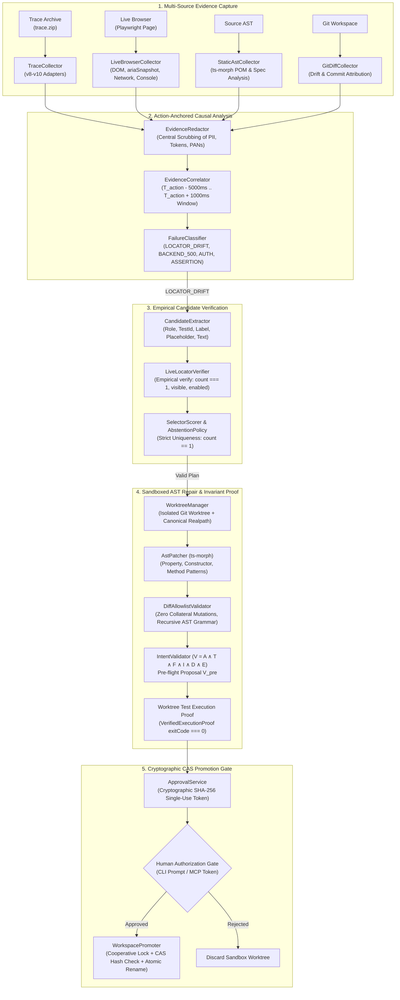

# Playwright Intelligence Engine (pw-intel) v1.0.0

[](https://www.typescriptlang.org/)
[](https://playwright.dev/)
[-brightgreen.svg)]()
[-success.svg)]()
[](LICENSE)

An enterprise-grade, deterministic intelligence, diagnosis, and self-healing engine for Microsoft Playwright suites. Operates with zero mandatory cloud backend, zero forced LLM dependencies, and zero unsolicited file mutations. Ingests post-mortem trace archives (`trace.zip`), performs multi-source live browser reproductions (`pw-intel reproduce`), classifies failures via action-anchored causal graphs, scores candidates via probabilistic models, enforces strict intent invariants ($V = A \land T \land F \land I \land D \land E$), and promotes verified repairs via cryptographic token authorization and atomic Compare-And-Swap (CAS) file operations.

---

## Key Differentiators

| Capability | Playwright Intelligence Engine v2.6 | Generic Auto-Healers | LLM Code Agents |
| :--- | :--- | :--- | :--- |
| **Execution Model** | **Local-First & Deterministic** (Node.js ESM) | In-browser DOM mutation proxies | Non-deterministic prompt completions |
| **Diagnostic Model** | **Action-Anchored Causal Graph** ($T_{\text{action}}$ window) | Shallow string matching (`TimeoutError`) | Unstructured prompt reasoning |
| **Reproduction** | **Live Multi-Source Collectors** (DOM, ariaSnapshot, net) | None | Re-runs full suite blindly |
| **Candidate Scoring** | Calibrated Sigmoid Probability $P(\text{valid})$ | Ad-hoc priority lists / CSS heuristics | Unconstrained token generation |
| **Negative Control Gate** | **Strict Safe Abstention** on $count \neq 1$, 5xx, 401/403, assertion bugs | Blindly repairs or clicks first DOM match | Hallucinates locators for broken apps |
| **Defect Resistance** | **100% Detection** (0.0% False Repairs, 0.0% Bug Masking) | Masks application bugs by altering assertions | Weakens assertions to force tests green |
| **Intent Verification** | **$V = A \land T \land F \land I \land D \land E$** (AST-level) | None | Arbitrary unstructured diffs |
| **Mutation Safety** | **Isolated Git Worktree + CAS Atomic Promotion** | In-place file modification | Overwrites active branch directly |
| **Authorization** | **Cryptographic Single-Use Approval Token** (SHA-256 bound) | Auto-commits without human review | Uncontrolled workspace mutation |

---

## Architectural Overview



---

## Quickstart & Installation

### Prerequisites
- Node.js >= 20.0.0
- Git >= 2.30.0
- Playwright >= 1.40.0

```bash
# Clone the repository
git clone https://github.com/enterprise/playwright-intelligence-engine.git
cd playwright-intelligence-engine

# Install dependencies
npm install

# Run typecheck and compile
npm run typecheck
npm run build

# Run complete test suite (398 tests across 26 test files)
npm test

# Verify the complete repository baseline (typecheck, tests, and build)
npm run verify:baseline

# Run empirical real browser benchmark suite
npm run benchmark
```

---

## Command Line Interface (CLI)

The engine provides a standalone binary `pw-intel`:

```bash
# 1. Diagnose a failing Playwright trace archive
npx pw-intel diagnose ./playwright-traces/trace.zip

# 2. Reproduce a failing spec with live multi-source diagnostic collectors
npx pw-intel reproduce ./e2e/login.spec.ts

# 3. Execute the empirical browser benchmark suite in headless Chromium
npx pw-intel benchmark

# Benchmark options:
npx pw-intel benchmark --family "Dynamic IDs"      # Filter Tier 2 mutations by family
npx pw-intel benchmark --scenario "500"            # Filter Tier 3 negative controls
npx pw-intel benchmark --browser firefox           # Target alternative browser engine

# 4. Start the Model Context Protocol (MCP) JSON-RPC server on stdio
npx pw-intel mcp

# 5. Inspect an external Playwright repository testbed
npx pw-intel inspect-testbed D:/Work/pie-real-repository-testbed --json --out D:/Work/pie-real-repository-testbed/manifests/pie-inspection-manifest.json

# 6. Run a bounded baseline command for a discovered repository
npx pw-intel run-testbed D:/Work/pie-real-repository-testbed --repository playwright-examples --timeout 60000 --out D:/Work/pie-real-repository-testbed/results/playwright-examples-baseline.json

# 7. Generate verified Page Object and Spec scaffolding
npx pw-intel generate UserDashboard

# 8. Run the bounded LLM repair agent and deterministic isolated verifier
npx pw-intel autonomous-repair ./playwright-traces/trace.zip --execute

# 9. Plan or write LLM-assisted scenarios through deterministic generators
npx pw-intel generate-agent requirements.json --mode brownfield --write --verify

# 10. Plan project-aware greenfield/brownfield architecture (create-only with --write)
npx pw-intel architect "Checkout Flow" --mode greenfield --requirements requirements.json

# 11. Convert Playwright JSON into CI evidence, annotations, and a quality gate
npx pw-intel ci-report playwright-report.json --repository checkout --out pie-ci-evidence.json
```

`autonomous-repair` does not write to the active workspace. With `--execute`,
PIE applies one validated operation in a disposable worktree, runs the target
test, and returns `VERIFIED_READY_FOR_APPROVAL` only when all deterministic
verification gates pass. Add `--promote` only when policy explicitly permits
promotion after those gates pass. `generate-agent` uses the configured provider only to
propose structured scenarios; PIE renders and optionally executes the generated
Playwright files.

---

## Empirical Benchmark Suite (Gate C)

The benchmark runner (`benchmarks/runner/master-benchmark-runner.ts`) executes **125 real end-to-end browser scenarios** in headless Chromium against a controlled `ControlledAppServer`. Outcomes, latencies, regressions, and defect masking rates are measured dynamically:

- **Tier 1 (5 baselines):** Clean authentication, catalog, cart, checkout, and admin journeys.
- **Tier 2 (60 mutations):** Controlled locator and DOM drift families, with live candidate verification, AST patching, browser re-execution, and regression checks. Results must be generated from the current build; historical figures are not release evidence.
- **Tier 3 (60 negative controls):** Backend, authentication, business-defect, ambiguity, assertion, missing-data, and unsupported-pattern controls. Reported safe abstention is 100%.
- **Confidence intervals:** See `benchmarks/reports/master-benchmark-results.json` for current Wilson intervals and sample interpretation.

Reports are saved to `artifacts/benchmark-report.json` and `artifacts/benchmark-report.md`.

---

## Model Context Protocol (MCP) Integration

The MCP server runs on `stdio` with fail-closed security:

1. `diagnose_trace`: Diagnoses a Playwright trace archive, returning causal classification, confidence, and recommended repairs.
2. `repair_page_object`: Two-stage workflow:
   - Calling without `approvalToken` stages the proposal in `ApprovalService` and returns `proposalId`, proposed diff, and cryptographic proposal metadata.
   - Calling with `approvalToken` validates token binding and promotes the patch atomically to the workspace using `WorkspacePromoter`.
3. `generate_playwright_test`: Generates Page Object and test scaffolding.
4. `plan_test_architecture`: Plans greenfield/brownfield project-aware generation and can create missing files explicitly.
5. `ingest_playwright_report`: Converts Playwright JSON to failure clusters, stability, CI gate, and annotations.
6. `get_product_status`: Reports product identity, safety policy, and available
   capability boundaries.

---

## Security Model

1. **Worktree-First Isolation:** All investigations, mutations, and exploratory re-runs execute in isolated Git worktrees (`.worktrees/`).
2. **Fail-Closed Intent Invariant v2:** Authorizing any repair requires satisfying:
   $$V = A \land T \land F \land I \land D \land E$$
   where $A$ = assertions preserved, $T$ = test body preserved, $F$ = fixtures preserved, $I$ = target identity preserved, $D$ = diff allowlist passed, $E$ = execution proof verified.
3. **Compare-And-Swap (CAS) Atomic Promotion:** `WorkspacePromoter` verifies canonical realpath containment, acquires cooperative file locks, verifies source hash against approved hash, writes to a temporary file, atomically replaces via `fs.renameSync`, and validates post-write SHA-256 hash.
4. **Subprocess Sanitization:** `ExecutionRunner` strips cloud keys and developer tokens, bounds output buffers to 16 MB, maps signals to `128 + signal`, and terminates process trees on timeout.
5. **Central Redaction:** `EvidenceRedactor` scrubs Bearer tokens, JWTs, credit card numbers, SSNs, and Basic Auth across all collectors prior to analysis.
