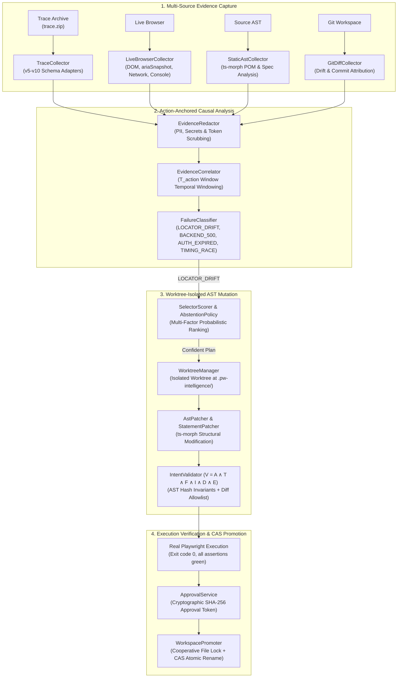

# Playwright Intelligence Engine (`pw-intel`)

[](https://www.npmjs.com/package/playwright-intelligence-engine)
[](https://www.typescriptlang.org/)
[](https://playwright.dev/)
[-brightgreen.svg?style=flat-square)]()
[](docs/INTENT_INVARIANTS.md)
[](LICENSE)

**PIE** is an open-source, verification-first test intelligence and autonomous repair engine for Microsoft Playwright suites.

Unlike generic LLM coding agents that guess locators or "self-healing" tools that silently weaken assertions to force green runs, PIE operates on a strict **mathematical invariant gate**:

$$\mathcal{V} = A \land T \land F \land I \land D \land E$$

> **The Verification-First Law:**  
> Never weaken an assertion. Never alter user input values. Never mask an application bug. When evidence is insufficient, **abstain**.

---

## ⚡ 30-Second Quickstart

No configuration required. Run it instantly in any existing Playwright repository:

### 1. Diagnose a Failing Test Trace
```bash
npx pw-intel diagnose ./test-results/trace.zip
```
PIE unpacks the trace archive, correlates the exact DOM snapshot at the failing action with network timeline events, and identifies the root cause (e.g., `LOCATOR_DRIFT`, `TIMING_RACE`, `AUTH_EXPIRED`, or `BACKEND_500`).

### 2. Autonomous Isolated Repair
```bash
npx pw-intel autonomous-repair ./test-results/trace.zip --execute
```
Creates a disposable Git worktree, plans safe AST replacements for Page Objects or inline statements, proves assertion invariance ($A \land T$), re-runs the target test in Chromium, and stages verified patches with a cryptographic SHA-256 approval token.

### 3. Generate Conventions-Aware Tests
```bash
npx pw-intel generate-agent ./requirements.json --mode brownfield --write --verify
```
Profiles your existing repository (`.pie/conventions.json`), reuses existing fixtures and Page Objects without generating duplicate login flows, and enforces a strict naming linter with **0 index-derived variable names** (e.g. rejects `button1`, `input2`).

---

## 📦 Installation

Install locally in your project:
```bash
npm install --save-dev playwright-intelligence-engine
```
Or install globally for system-wide CLI access:
```bash
npm install -g playwright-intelligence-engine
```

Both `pw-intel` and `playwright-intelligence-engine` binary aliases are available:
```bash
pw-intel --help
```

---

## 🤖 Model Context Protocol (MCP) Integration

PIE includes a built-in Model Context Protocol (MCP) server. You can integrate PIE directly into **Cursor**, **Windsurf**, or **Claude Code** so your AI coding agent uses deterministic Playwright intelligence instead of hallucinating selectors.

### Cursor / Windsurf Configuration
Add to your project's `.cursor/mcp.json` or user settings:
```json
{
  "mcpServers": {
    "playwright-intelligence": {
      "command": "npx",
      "args": ["-y", "playwright-intelligence-engine", "mcp"]
    }
  }
}
```

### Claude Desktop Configuration
Add to your `claude_desktop_config.json`:
```json
{
  "mcpServers": {
    "pw-intel": {
      "command": "npx",
      "args": ["-y", "playwright-intelligence-engine", "mcp"]
    }
  }
}
```

### Available MCP Tools
- `diagnose_trace`: Ingests Playwright traces and returns structured causal root-cause diagnoses.
- `repair_page_object`: Proposes isolated worktree repairs with cryptographic approval tokens.
- `generate_playwright_test`: Generates type-safe Page Object Models and test specs matching repository conventions.
- `plan_test_architecture`: Plans project-aware greenfield/brownfield test scaffolding.
- `ingest_playwright_report`: Converts Playwright JSON reports into failure clusters and CI annotations.

---

## 🛡️ Why PIE? (The Verification-First Difference)

| Capability | Generic Auto-Healers | Raw LLM Coding Agents | Playwright Intelligence Engine (PIE) |
| :--- | :--- | :--- | :--- |
| **Execution Model** | In-browser DOM mutation proxies | Generic prompt completions | **Deterministic Local Engine (Node.js ESM)** |
| **Bug Detection** | Masks bugs by clicking next match | Masks bugs by altering assertions | **100% Defect Detection (0.0% Bug Masking)** |
| **Assertion Safety** | Unchecked | Frequently deleted / commented out | **AST Invariant Proof ($A \land T$ strictly checked)** |
| **Locator Strategy** | Brittle CSS / XPath heuristics | Unconstrained token generation | **Calibrated multi-factor scoring ($P(\text{valid})$)** |
| **Negative Controls** | Blindly tries to repair 500s & auth | Hallucinates code for down servers | **Fail-Closed Safe Abstention** |
| **Workspace Safety** | Mutates active working tree | Overwrites developer branches | **Isolated Git Worktree + CAS Atomic Promotion** |
| **Code Style** | Hallucinates generic snippets | Random patterns, duplicate auth | **Runtime profiling (`.pie/conventions.json`)** |
| **Identifier Quality**| Generates `button_1`, `elem_2` | Variable name drift | **Strict Naming Linter (0 index-derived symbols)** |

---

## 🏛️ Architecture & Verification Pipeline



### The Invariant Gate
Every repair proposal must satisfy:
1. **$A$ (Assertion Invariant):** Canonical SHA-256 hash of all test assertions must remain identical.
2. **$T$ (Test-Body Invariant):** Control flow graph and statement sequence are strictly preserved.
3. **$F$ (Fixture Invariant):** Playwright fixtures, page parameters, and test setup remain untouched.
4. **$I$ (Target Identity):** Semantic target element role, label, and user action intent are preserved.
5. **$D$ (Diff Allowlist):** Only targeted locator strings or timing timeouts are patched; zero collateral mutations.
6. **$E$ (Execution Verification):** The test must execute cleanly to completion with exit code 0 in an isolated headless browser.

---

## 💻 CLI Command Reference

| Command | Description | Example |
| :--- | :--- | :--- |
| `pw-intel diagnose` | Ingests Playwright trace and reports causal root cause | `pw-intel diagnose trace.zip` |
| `pw-intel reproduce` | Reproduces a test with live DOM, ariaSnapshot, and network collectors | `pw-intel reproduce tests/login.spec.ts` |
| `pw-intel autonomous-repair` | Executes isolated worktree repair, verification, and staging | `pw-intel autonomous-repair trace.zip --execute` |
| `pw-intel generate` | Generates verified Page Object and Spec scaffolding | `pw-intel generate UserDashboard` |
| `pw-intel generate-agent` | Conventions-aware greenfield or brownfield test generation | `pw-intel generate-agent reqs.json --mode brownfield --write` |
| `pw-intel architect` | Plans architectural test structure across complex workflows | `pw-intel architect "Checkout" --mode greenfield` |
| `pw-intel benchmark` | Runs the 125-scenario empirical browser benchmark suite | `pw-intel benchmark --browser chromium` |
| `pw-intel ci-report` | Generates CI evidence, GitHub annotations, and SARIF | `pw-intel ci-report report.json --out ci-evidence.json` |
| `pw-intel mcp` | Starts the Model Context Protocol JSON-RPC server on stdio | `pw-intel mcp` |

---

## 🧪 Statistical & Benchmark Validation

PIE has been validated across empirical testbeds and rigorous adversarial suites:
- **661 Unit & Integration Tests (100% Pass Rate)** across 66 test suites.
- **20 Adversarial Invariant Tests (`INV-01` to `INV-20`)**: Verifying immunity to assertion deletion, timeout weakening, step reordering, argument tampering, and collateral AST corruption.
- **125 Real Browser Benchmark Scenarios**:
  - *Tier 1 (Baselines):* Full end-to-end shopping & admin flows.
  - *Tier 2 (Locator Mutations):* Dynamic IDs, label drift, structural hierarchy shifts.
  - *Tier 3 (Negative Controls):* 500 server crashes, 401 auth expiration, network dropped packets. Safe abstention rate: **100%**.
  - **Defect Detection Rate:** 100% (0.0% false repairs).

---

## 🛠️ Configuration & Optional LLM Assistance

Core diagnostics, candidate scoring, AST patching, and invariant validation are **100% local, offline, and deterministic**.

For semantic explanations and natural language test generation, you can optionally configure an LLM provider:

```bash
cp .env.example .env
```

Edit `.env`:
```ini
PIE_LLM_API_KEY=your-api-key
PIE_LLM_ENDPOINT=https://api.openai.com/v1/chat/completions
PIE_LLM_MODEL=gpt-4o
```
*(Compatible with OpenAI, DeepSeek, Claude, and local Ollama / vLLM endpoints).*

---

## 📖 In-Depth Documentation

- [System Architecture](docs/ARCHITECTURE.md)
- [CLI Reference Guide](docs/CLI_REFERENCE.md)
- [Exploration & Diagnosis Guide](docs/PIE_EXPLORATION_GUIDE.md)
- [Test Generation Guide](docs/PIE_GENERATION_GUIDE.md)
- [Worktree Verification Guide](docs/PIE_VERIFICATION_GUIDE.md)
- [Intent Invariants & Adversarial Matrix](docs/INTENT_INVARIANTS.md)
- [Security Model](docs/SECURITY_MODEL.md)

---

## 🤝 Contributing

We welcome contributions from the Playwright and testing community!

```bash
# 1. Clone repository
git clone https://github.com/your-org/playwright-intelligence-engine.git
cd playwright-intelligence-engine

# 2. Install dependencies
npm install

# 3. Run typecheck & test suite
npm run typecheck
npm test

# 4. Run verification quality gates
npm run verify:all
```

Please ensure all tests pass and quality gates report `VERDICT: OK` before opening a pull request.

---

## 📄 License

Apache License 2.0. See [LICENSE](LICENSE) for details.
