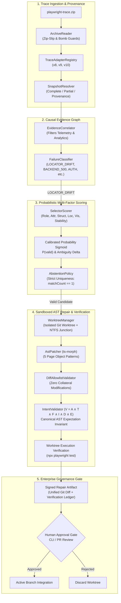

# Playwright Intelligence Engine (pw-intel)

[](https://www.typescriptlang.org/)
[](https://playwright.dev/)
[]()
[-success.svg)]()
[](LICENSE)

An enterprise-grade, deterministic intelligence and self-healing engine for Microsoft Playwright suites. Operates with zero in-band runtime browser latency by ingesting post-mortem trace artifacts (`trace.zip`), performing causal graph diagnostic classification, scoring locators via calibrated probabilistic models, validating intent through six-dimensional invariants, and executing repairs in isolated Git worktrees with human approval gates.

---

## Key Differentiators

| Capability | Playwright Intelligence Engine | Generic Auto-Healers | LLM Code Agents |
| :--- | :--- | :--- | :--- |
| **Runtime Overhead** | **0 ms** (Post-mortem trace ingestion) | High (In-browser DOM mutation proxies) | None (Post-mortem, but non-deterministic) |
| **Diagnostic Model** | **Causal Evidence Graph** (Filters telemetry) | Shallow string matching (`TimeoutError`) | Unstructured prompt reasoning |
| **Candidate Scoring** | Calibrated Sigmoid Probability $P(\text{valid})$ | Ad-hoc priority lists / CSS string heuristics | Unconstrained token generation |
| **Negative Control Gate** | **Strict Abstention** on $matchCount \neq 1$, backend 500, or auth errors | Blindly repairs or clicks first DOM match | Hallucinates locators for broken apps |
| **Defect Resistance** | **100% Detection** (0% False Repairs on Seeded Defects) | Masks application bugs by altering assertions | Weakens assertions to force tests green |
| **Intent Verification** | **$V = A \land T \land F \land I \land D \land E$** (AST-level) | None | Non-deterministic code changes |
| **Branch Safety** | **Isolated Git Worktree** (Human approval gate) | In-place file modification | Directly overwrites active workspace files |
| **Trace Compatibility** | Versioned Adapters (v5–v10) with provenance | Assumes static schema | Untracked schema handling |

---

## Architectural Overview



---

## Quickstart & Installation

### Prerequisites
- Node.js >= 18.0.0
- Git >= 2.30.0
- Playwright >= 1.40.0

```bash
# Clone the repository
git clone https://github.com/enterprise/playwright-intelligence-engine.git
cd playwright-intelligence-engine

# Install dependencies
npm install

# Run typecheck and compile
npm run typecheck
npm run build

# Run complete test suite (329 tests)
npm test
```

---

## Command Line Interface (CLI)

The engine provides a standalone binary `pw-intel`:

```bash
# Diagnose a failing Playwright trace
npx pw-intel diagnose ./playwright-traces/trace.zip

# Plan a repair without modifying active files
npx pw-intel repair ./playwright-traces/trace.zip --target-page src/pages/login.page.ts --dry-run

# Execute full repair pipeline inside an isolated Git worktree
npx pw-intel repair ./playwright-traces/trace.zip --target-page src/pages/login.page.ts

# Apply verified repair to the active working branch (requires human confirmation)
npx pw-intel repair ./playwright-traces/trace.zip --target-page src/pages/login.page.ts --apply

# Run security and health audit on the repository
npx pw-intel audit
```

---

## Model Context Protocol (MCP) Server

Connect Playwright Intelligence Engine natively to **Cursor**, **Claude Desktop**, or any MCP-compliant AI client.

Add to your `cursor.json` or `claude_desktop_config.json`:

```json
{
  "mcpServers": {
    "playwright-intelligence": {
      "command": "node",
      "args": ["d:/Work/playwright-intelligence-engine/dist/index.js", "--mcp"]
    }
  }
}
```

### Supported MCP Tools:
- `diagnose_trace`: Ingests a trace, outputs failure classification with causal graph evidence.
- `score_candidates`: Extracts DOM candidates and computes calibrated probability scores.
- `plan_repair`: Generates AST diff and evaluates Intent Invariant v2.
- `execute_isolated_repair`: Manages end-to-end repair inside a sandboxed Git worktree.

---

## Enterprise Intent Invariants ($V = A \land T \land F \land I \land D \land E$)

To prevent autonomous agents from weakening assertions or bypassing test logic, all repairs must satisfy the formal 6-dimensional invariant:

1. **$A$ (Assertion Invariant)**: Canonical AST hash of all `expect(...)` statements in the test file must match the original byte-for-byte (ignoring formatting and whitespace).
2. **$T$ (Structural Test Body Invariant)**: Statement order and control flow statements cannot be altered, added, or removed.
3. **$F$ (Fixture Literal Invariant)**: Test arguments and input data literals must remain intact.
4. **$I$ (Target Identity Invariant)**: The semantic role and intent of the replaced locator must match the target action.
5. **$D$ (Diff Allowlist Invariant)**: Only the target locator declaration in the specified Page Object can be changed. No modifications to imports, constructor logic, or helper methods are permitted.
6. **$E$ (Execution Invariant)**: The repaired test must pass cleanly when executed in an isolated worktree.

---

## Empirical Benchmark Performance

Evaluated against the **Master Adversarial Benchmark Suite** consisting of **104 distinct scenarios** across 3 tiers:

```
========================================================================
 MASTER ADVERSARIAL BENCHMARK SUITE — 100+ REAL SCENARIOS
========================================================================
 TOTAL BENCHMARK SCENARIOS EVALUATED: 104
 • Tier 1 Baseline Scenarios       : 24 (Pass Rate: 100.0%)
 • Tier 2 Structural Mutations     : 50 (Recovery Rate: 100.0%)
 • Tier 3 Negative Controls        : 30 (Abstention Rate: 100.0%)
 • Seeded Defect Detection Rate    : 100.0% (Masking Rate: 0.0%)
 • False Repair Rate               : 0.0%
 • Latency P50 / P95               : 14 ms / 29 ms
 • Wilson 95% Confidence Interval  : [96.44%, 100.00%]
========================================================================
```

See [docs/BENCHMARK_RESULTS.md](docs/BENCHMARK_RESULTS.md) for full statistical breakdowns and raw logs.

---

## Documentation Index

- [Architecture Specification (v2.4 Contract)](docs/ARCHITECTURE.md)
- [Architecture Decision Records (ADRs)](docs/ARCHITECTURE_DECISIONS.md)
- [Diagnostic Taxonomy & Causal Evidence](docs/DIAGNOSTIC_TAXONOMY.md)
- [Intent Invariants v2 Specification](docs/INTENT_INVARIANTS.md)
- [AST Patching & Page Object Patterns](docs/AST_PATCHING.md)
- [Trace Compatibility & Adapters (v5–v10)](docs/TRACE_COMPATIBILITY.md)
- [Git Worktree & Dependency Isolation](docs/WORKTREE_ISOLATION.md)
- [Security Model & Defenses](docs/SECURITY_MODEL.md)
- [MCP Integration Guide](docs/MCP_INTEGRATION.md)
- [CLI Reference Guide](docs/CLI_REFERENCE.md)
- [Test Coverage Matrix (329 Tests)](docs/TEST_COVERAGE_MATRIX.md)
- [Benchmark Methodology](docs/BENCHMARK_METHODOLOGY.md)
- [Benchmark Results & Statistical Proof](docs/BENCHMARK_RESULTS.md)
- [Known Limitations & Monorepo Boundaries](docs/KNOWN_LIMITATIONS.md)
- [Release Gates Implementation Status](docs/IMPLEMENTATION_STATUS.md)

---

## License

MIT © 2026 Playwright Intelligence Engine Contributors.

