# Playwright Intelligence Engine — Architecture Specification (v2.4 As-Built)

**Version:** 2.4 Enterprise Architecture Baseline  
**Language & Runtime:** TypeScript 5.9 / Node.js 20+ (ESM, strict NodeNext)  
**Verification Baseline:** 329 Passed Tests | 104 Adversarial Scenarios | 100% Defect Resistance | 0.0% False Repairs  

---

## 1. Executive Architectural Tenets

1. **Deterministic Controller Over Unbounded Agents**:  
   The execution lifecycle, failure classification, candidate scoring, AST transformations, and verification workflows are governed entirely by deterministic, strongly typed TypeScript state machines. LLM involvement is strictly isolated to optional semantic disambiguation and bounded candidate ranking. The engine never allows an LLM to freely generate code modifications or execute unconstrained file writes.

2. **Zero In-Band Runtime Overhead**:  
   Unlike legacy auto-healing libraries that inject intrusive browser proxies or monkey-patch `page.click()` at runtime, Playwright Intelligence Engine operates strictly out-of-band via post-mortem trace ingestion (`trace.zip`). Test execution speed in CI/CD is unaltered.

3. **Abstention as a Successful Safety Outcome**:  
   When evidence is ambiguous, when multiple elements match, when trace artifacts are incomplete, or when failures stem from backend infrastructure (HTTP 500, expired authentication, offline networks), the engine **strictly abstains** from attempting code modifications. An explicit diagnostic explanation is generated with zero file mutation.

4. **Multi-Dimensional Intent Invariant ($V = A \land T \land F \land I \land D \land E$)**:  
   Code modifications are formally verified across six dimensions before being proposed: Assertion Fingerprinting ($A$), Structural Control Flow ($T$), Critical Fixtures ($F$), Target Identity & Action Semantics ($I$), Diff Allowlist ($D$), and Worktree Execution ($E$).

5. **Sandbox Isolation & Enterprise Governance**:  
   All repairs and executions are isolated in detached Git worktrees (`.pw-intelligence/worktrees/*`). Active working branches and developer workspaces are never modified autonomously. Applying a verified patch requires explicit human review and approval.

---

## 2. System Architecture & Component Interaction

```mermaid
flowchart TD
    subgraph IngestionSubsystem["Subsystem A: Trace Ingestion & Provenance"]
        ArchiveReader["ArchiveReader\n• Zip-Slip Protection\n• Decompression Bomb Guards\n• Streaming JSONL Limits"]
        TraceAdapterRegistry["TraceAdapterRegistry\n• V8TraceAdapter (v7/v8)\n• V9TraceAdapter (v9)\n• V10TraceAdapter (v10)\n• UnknownTraceAdapter (Abstain)"]
        SnapshotResolver["SnapshotResolver\n• Provenance (frameId, callId, phase)\n• Completeness (COMPLETE/PARTIAL/UNAVAIL)\n• Ref Unresolved Warnings"]
        
        ArchiveReader --> TraceAdapterRegistry
        TraceAdapterRegistry --> SnapshotResolver
    end

    subgraph DiagnosticSubsystem["Subsystem B: Causal Evidence Graph & Diagnostics"]
        EvidenceCorrelator["EvidenceCorrelator\n• Telemetry Domain Filtering\n• Endpoint Exclusion (/metrics, /beacon)\n• Causal Chain Linking"]
        FailureClassifier["FailureClassifier\n• LOCATOR_DRIFT\n• BACKEND_500\n• AUTH_EXPIRED\n• ASSERTION_FAILURE\n• TIMING_RACE"]
        
        SnapshotResolver --> EvidenceCorrelator
        EvidenceCorrelator --> FailureClassifier
    end

    subgraph IntelligenceSubsystem["Subsystem C: Candidate Extraction & Calibrated Scoring"]
        CandidateExtractor["CandidateExtractor\n• Action Semantic Filtering (click/fill)\n• Token Normalization\n• Accessibility Hierarchy"]
        SelectorScorer["SelectorScorer\n• Heuristic Score S(L)\n• Calibrated Probability Sigmoid P(valid)\n• Volatility Penalties"]
        AbstentionPolicy["AbstentionPolicy\n• Strict Uniqueness Gate (matchCount == 1)\n• Confidence Gate (>= 0.75)\n• Ambiguity Delta (>= 0.08)"]
        
        FailureClassifier -->|LOCATOR_DRIFT| CandidateExtractor
        CandidateExtractor --> SelectorScorer
        SelectorScorer --> AbstentionPolicy
    end

    subgraph RepairSubsystem["Subsystem D: Sandboxed AST Repair & Verification"]
        WorktreeManager["WorktreeManager\n• Detached Git Worktree\n• DependencyStrategyResolver\n• Windows NTFS Junction Safety"]
        AstPatcher["AstPatcher (ts-morph)\n• 5 Static Page Object Patterns\n• Rejects Dynamic Parameterized Locators"]
        DiffAllowlist["DiffAllowlistValidator\n• Rejects Import Mutations\n• Rejects Method / Property Additions"]
        IntentValidator["IntentValidator\n• Canonical Expectation AST Hash\n• Structural Statement Preservation"]
        ExecutionRunner["ExecutionRunner\n• Isolated 'npx playwright test'\n• Zero Shell Injection"]
        
        AbstentionPolicy -->|Approved Candidate| WorktreeManager
        WorktreeManager --> AstPatcher
        AstPatcher --> DiffAllowlist
        DiffAllowlist --> IntentValidator
        IntentValidator --> ExecutionRunner
    end

    subgraph GovernanceSubsystem["Subsystem E: Governance & Interfaces"]
        SignedArtifact["Signed Repair Artifact\n• Unified Diff\n• Verification Ledger\n• Causal Evidence Metadata"]
        CLI["PwIntelCli (Terminal)"]
        MCP["PlaywrightIntelligenceMcpServer\n(JSON-RPC 2.0 stdio for Cursor/Claude)"]
        HumanReview{"Human Approval Gate"}

        ExecutionRunner --> SignedArtifact
        SignedArtifact --> CLI
        SignedArtifact --> MCP
        CLI --> HumanReview
        MCP --> HumanReview
    end
```

---

## 3. Subsystem Detailed Specifications

### Subsystem A: Trace Ingestion & Provenance (`src/trace/`)
- **`ArchiveReader`**: Ingests Playwright `trace.zip` archives. Enforces path traversal prevention (Zip-Slip defense), limits uncompressed file size to 100MB (decompression bomb defense), caps maximum archive entries at 10,000, and restricts streaming JSONL reader buffers.
- **`TraceAdapterRegistry`**: Detects and adapts internal trace formats across Playwright versions:
  - `V8TraceAdapter`: Playwright v1.30–v1.39 traces (schema v7/v8).
  - `V9TraceAdapter`: Playwright v1.40–v1.44 traces (schema v9).
  - `V10TraceAdapter`: Playwright v1.45+ traces (schema v10).
  - `UnknownTraceAdapter`: Rejects unsupported formats with an explicit `UNSUPPORTED_TRACE_FORMAT` error.
- **`SnapshotResolver`**: Resolves array-based DOM snapshot tuples into hierarchical element trees. Records provenance metadata (`frameId`, `callId`, `phase`), categorizes completeness (`COMPLETE`, `PARTIAL`, `UNAVAILABLE`), and identifies unresolved element references.

### Subsystem B: Causal Evidence Graph & Diagnostics (`src/diagnostics/`)
- **`EvidenceCorrelator`**: Constructs a directed causal graph connecting network events, console logs, and action timestamps. Prevents false-positive backend classifications by stripping non-causal telemetry domains (`google-analytics.com`, `sentry.io`, `datadoghq.com`) and endpoints (`/metrics`, `/beacon`, `/favicon.ico`).
- **`FailureClassifier`**: Evaluates normalized evidence into grounded diagnostic categories:
  - `LOCATOR_DRIFT`: Action failed due to missing, relocated, or mutated DOM target, with healthy server responses.
  - `BACKEND_500`: Action preceded or accompanied by a failing in-domain application API request.
  - `AUTH_EXPIRED`: Authentication token revoked or rejected (HTTP 401/403 or redirect to login).
  - `ASSERTION_FAILURE`: Action succeeded, but test expectation condition failed.
  - `TIMING_RACE`: Element appeared shortly after timeout or DOM was actively mutating.
  - `INCOMPLETE_EVIDENCE`: Trace missing critical snapshots or DOM trees required for diagnosis.

### Subsystem C: Candidate Extraction & Calibrated Scoring (`src/selector/`)
- **`CandidateExtractor`**: Discovers candidate elements in the resolved DOM snapshot matching the failed action's required semantics (e.g. `<button>`, `role="button"`, `<a>` for click; `<input>`, `<textarea>` for fill).
- **`SelectorScorer`**: Evaluates candidates across multiple orthogonal dimensions:
  $$S(L) = 0.40 \cdot S_{role} + 0.25 \cdot S_{attr} + 0.15 \cdot S_{struct} + 0.10 \cdot S_{loc} + 0.10 \cdot S_{vis} - P_{dynamic}$$
  Computes calibrated probability via logistic sigmoid:
  $$P(\text{valid}) = \frac{1}{1 + e^{-k(S(L) - S_0)}}$$
- **`AbstentionPolicy`**: Strict multi-stage decision pipeline:
  1. *Stage 1: Supported Element*: Element must be an interactive HTML tag or ARIA widget.
  2. *Stage 2: Target Identity*: Normalized token match against original locator intent.
  3. *Stage 3: Strict Uniqueness*: Candidate must match exactly 1 element in DOM ($matchCount === 1$). If $\ge 2$ matches exist and parent scope is unverified, **abstain immediately**.
  4. *Stage 4: Action Semantics*: Element tag and role must permit the target action.
  5. *Stage 5: Confidence Threshold*: Calibrated score $P(\text{valid}) \ge 0.75$.
  6. *Stage 6: Ambiguity Delta*: Top candidate must exceed runner-up by $\Delta \ge 0.08$.

### Subsystem D: Sandboxed AST Repair & Verification (`src/repair/` & `src/sandbox/`)
- **`WorktreeManager` & `DependencyStrategyResolver`**: Creates isolated Git worktrees. Resolves package manager strategy:
  - `npm`: Links `node_modules` via Windows NTFS Directory Junctions (`IMMUTABLE_SHARED`). Unlinks junctions prior to worktree removal.
  - `pnpm`: Identifies virtual store (`SHARED_MUTABLE`) and emits cache integrity warnings.
  - `yarn pnp`: Detects `.pnp.cjs` and rejects with `UNSUPPORTED`.
- **`AstPatcher`**: Uses `ts-morph` to safely patch 5 static Page Object patterns:
  1. Class property initializers (`readonly btn = this.page.locator(...)`).
  2. Class getters (`get btn() { return this.page.locator(...); }`).
  3. Constructor assignments (`this.btn = this.page.locator(...)`).
  4. Parameterless factory methods (`getBtn() { return this.page.locator(...); }`).
  5. Standalone locator constants (`export const BTN = ...`).
  Rejects parameterized helper methods (`row(id: string)`) with `AST_PARAMETERIZED_LOCATOR`.
- **`DiffAllowlistValidator`**: Inspects AST diff to ensure *only* the authorized locator initializer was modified. Rejects any changes to imports, class inheritance, methods, or constructor parameters.
- **`IntentValidator`**: Enforces $V = A \land T \land F \land I \land D \land E$. Computes canonical, formatting-insensitive SHA-256 hash of all `expect()` nodes. Verifies statement sequences and test literals.
- **`ExecutionRunner`**: Runs isolated Playwright test in worktree, parsing stdout/stderr without shell injection risks.

### Subsystem E: Interfaces & Governance (`src/cli/` & `src/mcp/`)
- **`PwIntelCli`**: Command-line interface providing `diagnose`, `repair`, `verify`, and `audit` commands.
- **`PlaywrightIntelligenceMcpServer`**: Full Model Context Protocol JSON-RPC 2.0 stdio server, exposing diagnostic and repair capabilities directly to Cursor and Claude Desktop.
- **Human Approval Gate**: Zero automated modification of active developer branches. All repairs produce structured diff artifacts requiring manual confirmation before merge.

---

## 4. Benchmark Verification Summary

The architecture was evaluated against the **Master Adversarial Benchmark Suite** consisting of **104 real scenarios**:
- **Tier 1 Baseline Scenarios (24)**: Pass Rate: **100.0%**.
- **Tier 2 Structural Mutations (50)**: Recovery Rate: **100.0%**.
- **Tier 3 Negative Controls (30)**: Abstention Rate: **100.0%**.
- **Seeded Defect Detection Rate**: **100.0%** (Defect Masking: **0.0%**).
- **False Repair Rate**: **0.0%**.
- **Execution Latency**: P50 = 14 ms, P95 = 29 ms.
- **Statistical Confidence**: Wilson 95% CI: `[96.44%, 100.00%]`.

