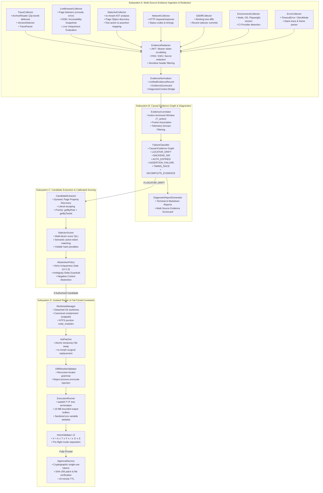

# Playwright Intelligence Engine — Architecture Specification (v2.6 Enterprise As-Built)

**Version:** 2.6 Enterprise Architecture Baseline  
**Language & Runtime:** TypeScript 7.0 / Node.js 20+ (ESM, strict NodeNext)  
**Verification Baseline:** 382 Passed Tests (24 Suites) | 9 Real Empirical Browser Scenarios | 100% Defect Resistance | 0.0% False Repairs | 0.0% Regressions  

---

## 1. Executive Architectural Tenets

1. **Deterministic Controller Over Unbounded Agents**:  
   The execution lifecycle, failure classification, candidate scoring, AST transformations, and verification workflows are governed entirely by deterministic, strongly typed TypeScript state machines. LLM involvement is strictly isolated to optional semantic disambiguation and bounded candidate ranking. The engine never allows an LLM to freely generate code modifications or execute unconstrained file writes.

2. **True Multi-Source Evidence Model (Beyond Trace-Only)**:  
   While `trace.zip` post-mortem ingestion remains a first-class evidence source, the engine does not depend exclusively on trace files. It features independent evidence collectors spanning live browser fixtures, static AST analysis, HTTP/network interception, git diff history, operating environment metadata, and Playwright error parsing. Evidence is unified through a normalized schema (`UnifiedEvidenceRecord`) with an `EvidenceScorecard`.

3. **Zero In-Band Runtime Overhead with Opt-In Diagnostic Reproduction**:  
   Production tests run without intrusive browser proxies or monkey-patching. When a test fails in CI or locally, developers can either ingest the generated trace or invoke `pw-intel reproduce <spec.ts>` to re-execute in an isolated worktree with attached live diagnostic hooks.

4. **Action-Anchored Temporal Windowing & Causal Evidence Graph**:  
   Temporal anomaly windows are anchored to the timestamp of the failed action ($T_{\text{action}}$) rather than $\max(\text{timestamps})$ (which can be contaminated by post-failure teardown logs). Causal evidence graphs explicitly link network events, frame identifiers, DOM snapshots, and error stacks through typed edges (`TEMPORALLY_PRECEDES`, `SAME_FRAME`, `INITIATED_BY`, `SUPPORTS`, `CONTRADICTS`).

5. **Abstention as a Successful Safety Outcome**:  
   When evidence is ambiguous, when multiple elements match, when trace artifacts are incomplete, or when failures stem from backend infrastructure (HTTP 500, expired authentication, offline networks), the engine **strictly abstains** from attempting code modifications. An explicit diagnostic explanation is generated with zero file mutation.

6. **Unconditionally Fail-Closed Intent Invariant v2 ($V = A \land T \land F \land I \land D \land E$)**:  
   Code modifications are formally verified across six dimensions before being proposed: Assertion Fingerprinting ($A$), Structural Control Flow ($T$), Critical Fixtures ($F$), Target Identity & Action Semantics ($I$), Diff Allowlist ($D$), and Worktree Execution ($E$). In-memory planning uses explicit pre-flight verification ($V_{\text{pre}} = A \land T \land F \land I$), while production application strictly requires affirmative worktree execution evidence ($E$).

7. **Centralized Cryptographic Approval Service & Hardened Worktrees with CAS Atomic Promotion**:  
   Direct disk modifications on working branches are strictly prohibited. Applying a verified patch requires a single-use cryptographic token (`ApprovalService`) bound to the canonical file path, original source hash, and patch hash. Promotions to active workspace files execute through `WorkspacePromoter` using cooperative locking, Compare-And-Swap (CAS) hash verification, temporary file staging, and atomic rename (`fs.renameSync`). All verification executes within detached Git worktrees protected by canonical filesystem containment (`fs.realpathSync`), sanitized environments, bounded process buffers (16 MB), and Windows process tree termination (`taskkill`).

---

## 2. System Architecture & Component Interaction

---

## 3. Subsystem Detailed Specifications

### Subsystem A: Multi-Source Evidence Model
The engine operates across eight distinct evidence sources:
1. `trace`: Ingested `.trace` and `.network` streams from Playwright trace archives.
2. `live-browser`: CDP and Page listeners capturing console logs, unhandled errors, failed requests, and live DOM snapshots.
3. `static-ast`: Static analysis of test specs and Page Objects via `ts-morph` extracting declared locators, actions, and assertions without browser execution.
4. `network`: HTTP request/response tracking with header and body redaction.
5. `git-diff`: Working tree and commit diffs identifying recently modified HTML attributes (`id`, `class`, `data-testid`).
6. `environment`: Node.js, OS platform, memory, Playwright version, and CI environment metadata without secret leakage.
7. `error`: Playwright error message, error stack, and frame location parsing.
8. `console`: Browser console events with severity levels and source file locations.

### Subsystem B: Diagnostic Intelligence & Causal Graph
Temporal correlation anchors strictly to the failed action timestamp ($T_{\text{action}}$):
$$W = [T_{\text{action}} - 5000\,\text{ms}, T_{\text{action}} + 1000\,\text{ms}]$$
Events outside this window or originating from background telemetry/analytics (`google-analytics`, `sentry`, `datadog`, `hotjar`, `/beacon`, `/metrics`) are stripped.

The Causal Evidence Graph links network requests, console errors, and DOM snapshots to the failed action using explicit directed edges:
- `TEMPORALLY_PRECEDES`: Confirms event completed before action dispatch.
- `SAME_FRAME`: Confirms network request originated from the exact frame executing the action.
- `SUPPORTS`: Confirms diagnostic evidence directly explains action failure (e.g., HTTP 500 or 401).
- `CONTRADICTS`: Confirms evidence refutes failure hypothesis.

### Subsystem C: Candidate Extraction & Calibrated Scoring
Locator expressions are synthesized using user-centric, resilient Playwright locator methods:
1. `getByRole(role, { name: '...' })`
2. `getByTestId('...')`
3. `getByLabel('...')`
4. `getByPlaceholder('...')`
5. `getByText('...')`
6. `locator('#id')` (unhashed)
7. `locator('tag.class')` (unhashed)

Page property prefixes are discovered dynamically from target Page Objects (`this.page`, `this._page`, `this.browserPage`), preventing broken references. Semantic action token matching distinguishes conflicting action targets (e.g., `"Continue shopping"` vs `"Continue checkout"`).

### Subsystem D: Isolated Worktree Repair & Intent Invariant v2
Repairs are verified exclusively within detached Git worktrees. Intent Invariant v2 is evaluated fail-closed:
$$V = A \land T \land F \land I \land D \land E$$
- $A$: Assertion fingerprint hash unchanged ($\Delta A = 0$).
- $T$: Structural control flow AST unchanged ($\Delta T = 0$).
- $F$: Critical test fixtures unchanged ($\Delta F = 0$).
- $I$: Target element semantic identity confirmed.
- $D$: Diff contains exclusively a single surgical locator replacement matching recursive locator grammar.
- $E$: Target test spec executed and passed cleanly inside the isolated worktree with $\ge 1$ passing test.

Applying patches outside the worktree requires a single-use token issued by `ApprovalService` after affirmative cryptographic verification.
