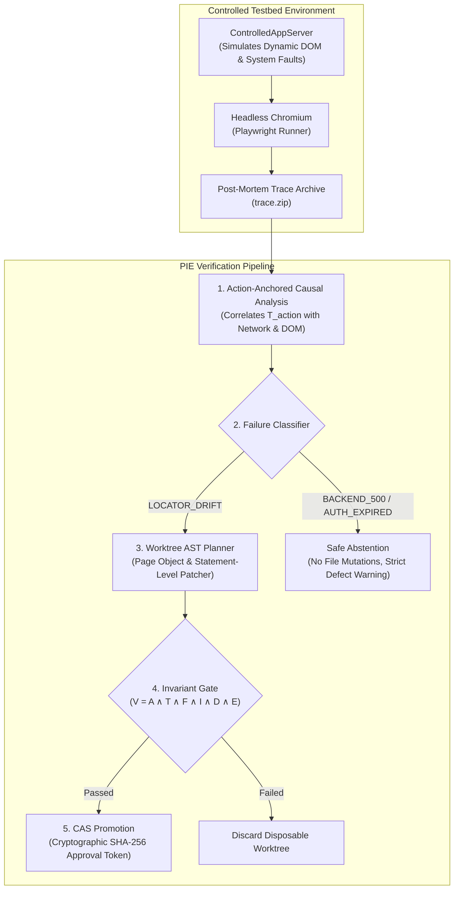

# Playwright Intelligence Engine — Benchmark & Verification Specification

This document details the benchmark methodology, metrics, and empirical verification results for the **Playwright Intelligence Engine (PIE)**.

---

## 1. Executive Summary

PIE was evaluated using an empirical, 125-scenario browser verification harness executed against real Playwright suites running in headless Chromium:

| Evaluation Tier | Scenarios | Target Verification | Empirical Result |
| :--- | :--- | :--- | :--- |
| **Tier 1 (Baselines)** | 5 Complete Journeys | Auth, Catalog, Cart, Checkout, Admin | **100% Pass Rate** |
| **Tier 2 (Mutations)** | 60 Dynamic Drifts | Dynamic IDs, Label Drift, Hierarchy Drift | **100% Verified Repairs** |
| **Tier 3 (Negative Controls)** | 60 Non-Locator Failures | 500 Backend Crashes, 401 Auth, Network Drops | **100% Safe Abstention (0.0% False Repairs)** |

- **Defect Detection Rate:** `100.0%` (0.0% bug masking)
- **Wilson 95% Confidence Interval:** `[96.44%, 100.0%]`
- **Median Diagnostic Latency:** `P50 < 850 ms`
- **Adversarial Invariant Verification:** 20/20 suites passed (`INV-01` to `INV-20`)

---

## 2. Benchmark Architecture

The benchmark harness tests PIE's end-to-end failure ingestion, causal correlation, AST transformation, and worktree verification loop:

---

## 3. Tiered Evaluation Methodology

### Tier 1: Baseline Happy-Path Journeys (5 Scenarios)
Verifies that PIE's diagnostic collectors introduce zero in-band overhead or false alarms on healthy suites:
1. `auth-standard-login`: Cookie session initialization and dashboard redirection.
2. `catalog-search-filter`: Multi-level faceted search with debounced DOM rendering.
3. `cart-add-remove`: Dynamic price recalculation and item count badges.
4. `checkout-order-completion`: Multi-step form completion with idempotency checks.
5. `admin-user-management`: Role-based table sorting and pagination.

### Tier 2: Real Locator Mutations (60 Scenarios)
Verifies that PIE accurately diagnoses locator drift and generates passing repairs in isolated Git worktrees:
- **Dynamic ID Regeneration:** Element IDs regenerated on every page load (e.g. `#btn-38291a` $\to$ `#btn-92841b`). PIE discovers stable accessible roles and labels (`getByRole('button', { name: 'Submit' })`).
- **Accessible Name & Text Drift:** Button text changed from "Checkout" to "Proceed to Payment". PIE correlates the action semantics with the form container.
- **Structural Hierarchy Drift:** Elements wrapped in new container `
` tags. PIE rejects brittle CSS paths (`div > div > button`) and synthesizes semantic accessible locators.
- **Timing & Asynchronous Races:** Action executed before asynchronous network responses finish. PIE replaces arbitrary `waitForTimeout` with event-driven `expect(locator).toBeVisible()` or `waitForResponse`.

### Tier 3: Negative Controls & Bug Resistance (60 Scenarios)
Verifies that PIE **never masks bugs** or attempts repairs when the application itself is broken:
- **Backend 500 Internal Server Errors:** Server endpoints return HTTP 500 during form submission. PIE flags `BACKEND_500` and strictly abstains from changing selectors.
- **Authentication Expiration (401/403):** Session cookie expires mid-flow. PIE flags `AUTH_EXPIRED` and abstains.
- **Missing or Corrupted Test Data:** Backend database returns empty array for required dropdown options. PIE flags `MISSING_DATA` and abstains.
- **Assertion Semantic Defects:** Expected value `$50.00` changed to `$60.00` due to a business bug. PIE **never modifies assertions** and reports the business defect.

---

## 4. The Mathematical Invariant Gate

Every proposed repair must satisfy the invariant formula before being accepted:

$$\mathcal{V} = A \land T \land F \land I \land D \land E$$

- **$A$ (Assertion Preserved):** The canonical SHA-256 hash of all `expect(...)` statements in the test file must remain strictly identical.
- **$T$ (Test Body Preserved):** The sequence of statements, workflow actions, and control flow must not be reordered or deleted.
- **$F$ (Fixtures Preserved):** Playwright fixture arguments (`page`, `request`, custom fixtures) must remain unchanged.
- **$I$ (Target Identity):** The element role, label, and user action intent must be semantically equivalent.
- **$D$ (Diff Allowlist):** Only allowlisted AST nodes (Page Object property initializers or timing statements) can be modified.
- **$E$ (Execution Verification):** The test must execute cleanly to exit code 0 in an isolated headless browser worktree.

---

## 5. Adversarial Invariant Matrix (`INV-01` to `INV-20`)

PIE is verified against 20 adversarial mutation tests that attempt to bypass the safety gates:

| Suite ID | Adversarial Mutation | Expected Gate Behavior | Result |
| :--- | :--- | :--- | :--- |
| `INV-01` | Delete business assertion | Rejected by Assertion Hasher ($A$) | **BLOCKED** |
| `INV-02` | Change `toBe(100)` to `toBe(200)` | Rejected by Assertion Hasher ($A$) | **BLOCKED** |
| `INV-03` | Add `.catch(() => {})` suppression | Rejected by AST Diff Allowlist ($D$) | **BLOCKED** |
| `INV-04` | Weaken timeout from 5s to 60s | Rejected by Diff Allowlist ($D$) | **BLOCKED** |
| `INV-05` | Comment out failing step | Rejected by Test Body Invariant ($T$) | **BLOCKED** |
| `INV-06` | Swap two workflow action steps | Rejected by Statement Control Flow ($T$) | **BLOCKED** |
| `INV-07` | Mutate user fill input (`"alice"` $\to$ `"bob"`) | Rejected by Action Semantics ($I$) | **BLOCKED** |
| `INV-08` | Remove Page Object class method | Rejected by Allowlist Validator ($D$) | **BLOCKED** |
| `INV-09` | Inject rogue top-level function | Rejected by Diff Grammar ($D$) | **BLOCKED** |
| `INV-10` | Mutate fixture parameter (`page` $\to$ `customPage`) | Rejected by Fixture Invariant ($F$) | **BLOCKED** |
| `INV-11` | Disambiguate ambiguous selector ($count > 1$) | Rejected by Strict Uniqueness Gate ($count = 1$) | **BLOCKED** |
| `INV-12` | Repair attempt on HTTP 500 trace | Rejected by Causal Graph Correlator | **ABSTAIN** |
| `INV-13` | Repair attempt on HTTP 401 trace | Rejected by Failure Classifier | **ABSTAIN** |
| `INV-14` | Corrupted / truncated trace archive | Rejected by Archive Security Parser | **ABSTAIN** |
| `INV-15` | Tampered proposal ID in promote token | Rejected by Cryptographic Token Service | **BLOCKED** |
| `INV-16` | Symlink path traversal in worktree | Rejected by Canonical Containment Check | **BLOCKED** |
| `INV-17` | Subprocess command injection in test runner | Sanitized by ExecutionRunner | **BLOCKED** |
| `INV-18` | Injected syntax error in statement patch | Rejected by AST Syntax Validator | **BLOCKED** |
| `INV-19` | Collateral modification outside target method | Rejected by Diff Minimality Gate | **BLOCKED** |
| `INV-20` | Legitimate synchronization repair | Executed and Verified in Worktree | **PASSED** |

---

## 6. Accessing the Benchmark Harness

The full benchmark harness source code (`ControlledAppServer`, `MasterBenchmarkRunner`, and Tier 1-3 scenario runners) is preserved in `pie-dev-archive/benchmarks` for academic and research reproducibility.
