# Implementation Baseline & Vulnerability Discovery Report
## Playwright Intelligence Engine (PIE) v2.4 Baseline Audit

**Audit Baseline Commit:** `202d9c0`  
**Date:** November 2026  
**Auditor:** Autonomous Systems & Security Architecture Team  
**Status:** DISCOVERY & BASELINE ESTABLISHED

---

## 1. Executive Summary & Verification of Findings

Following the independent code-level audit and full repository inspection, every finding reported by the external reviewer has been independently reproduced and verified against the actual source code in this repository:

1. **Benchmark Rigor (P0)**: `benchmarks/runner/master-benchmark-runner.ts` assigned `actualOutcome = expectedOutcome` in code for all 104 scenarios (Tier 1 baseline, Tier 2 mutations, Tier 3 negative controls) without executing Playwright tests or running the repair engine. **Confirmed: Synthetic outcomes.**
2. **Direct-Write Mutation Bypasses (P0)**:
   - `src/mcp/server.ts` (`repair_page_object` tool) called `patcher.patchPageObject()` directly on the active repository file without isolated worktree execution, without approval tokens, and ignored `assertionIntact === false`.
   - `src/repair/repair-planner.ts` (`planAndExecute()`) directly mutated `input.pomFilePath` on disk, returning `repairedSuccessfully: true` with `0ms` test duration without running any test.
3. **Fail-Open Invariants (P0)**: `src/repair/intent-validator.ts` lines 308–336 defaulted `diffAllowlistPassed = true` and `executionVerified = true` when inputs were missing, unless `target.strict` was explicitly passed.
4. **Filesystem Traversal & Symlink Vulnerability (P0)**:
   - `src/mcp/server.ts` `assertPathInWorkspace()` performed lexical `path.resolve` string checking without canonical `fs.realpathSync` evaluation, allowing symlinks pointing outside the workspace to pass.
   - `src/sandbox/worktree-manager.ts` (`createWorktree`, `destroyWorktree`) took unvalidated `id` parameters directly resolved via `path.resolve(this.baseWorktreeDir, id)`, allowing path traversal tokens (`../../`) to target arbitrary directories for recursive deletion.
   - `src/repair/repair-planner.ts` resolved `worktreePomPath` without post-resolution containment checks.
5. **Locator Argument Code Injection (P0)**: `src/repair/diff-allowlist.ts` `validateLocatorGrammar` checked only the outer call chain (`getByRole`, `locator`) without recursively validating AST argument nodes, allowing `process.env.TOKEN`, dynamic functions, and executable expressions to pass.
6. **ExecutionRunner Signal Masking & Environment Leakage (P0)**:
   - `src/sandbox/execution-runner.ts`: `exitCode: code ?? (timedOut ? -1 : 0)`. When terminated by signal (SIGKILL, OOM), `code` is null, reporting exit code `0` (false pass).
   - Inherited complete unscrubbed `process.env`.
   - Did not terminate full process tree on Windows/Linux on timeout.
7. **TraceParser Inconsistent DOM Metadata (P0)**: `src/trace/trace-parser.ts` line 240 reported `evidenceCompleteness: { domAvailable: true }` while returning `snapshots: {}`.
8. **Trace Monoculture & Lack of Multi-Source Diagnostics (P1)**: The diagnostic engine is strictly coupled to `trace.zip` files; lacks live browser event collectors, static AST-only diagnosis, environment collectors, Git diff collectors, and diagnostic rerun capabilities.
9. **Unverified Locator Uniqueness & Fallback Selectors (P1)**: Uniqueness calculated from static snapshot counts rather than live `await locator.count() === 1`; `candidate-extractor.ts` still fell back to bare tags `locator('<tag>')` and hardcoded `this.page`.
10. **Non-Causal Network Classification (P1)**: `evidence-correlator.ts` used $\max(\text{all timestamps})$ instead of the action timestamp $T_{\text{action}}$, and classified any 500/401/403 as causal without frame or request correlation.

---

## 2. Feature Inventory: Implemented vs. Partial vs. Missing

| Subsystem | Implemented Features | Partially Implemented (Defects) | Missing Features |
| :--- | :--- | :--- | :--- |
| **Ingestion** | Zip-Slip lexical checks, streaming JSONL line parsing. | `DEFAULT_MAX_SIZE = 500MB` (claimed 100MB); no compression ratio check; no matching worker/stream IDs. | Safe private extraction dir; stream ID matching; strict 10:1 ratio. |
| **Trace Adapters** | Adapters for v8, v9, v10; Unknown adapter. | All version adapters delegate to identical `TraceParser`; no `v7-adapter.ts` exists. | Actual version-specific normalization schemas; verified trace fixtures. |
| **Diagnostics** | 14 failure classification categories; telemetry domain filtering. | Correlator uses `max(timestamps)` instead of $T_{\text{action}}$; classifier checks unwindowed context; non-causal network labeling. | Action-anchored time window; frame & request initiator tracking; explicit evidence graph edges (`TEMPORALLY_PRECEDES`, `INITIATED_BY`). |
| **Multi-Source Evidence** | Trace parser extracts console, network, and action records. | Trace-only. No live browser listeners or AST-only investigation. | `UnifiedEvidenceModel` (Zod schemas); `LiveBrowserCollector` fixture; `StaticAstCollector`; `GitDiffCollector`; `EnvironmentCollector`. |
| **Reproduction** | None. | None. | `pw-intel reproduce <test> --with-diagnostics` isolated runner. |
| **AST Patching** | 5 Page Object design patterns via `ts-morph` in-memory. | `AstPatcher.patchPageObject()` does save-and-rollback instead of atomic file swap. | True atomic temp-file write and rename; discovering Page Object property (not hardcoding `this.page`). |
| **Diff Allowlist** | Checks top-level functions, imports, class member counts. | `validateLocatorGrammar` does not recursively validate nested argument ASTs. | Recursive AST argument validation (rejecting `process.env`, calls, arrow functions); strict locator grammar. |
| **Intent Invariants** | Canonical AST hashing, fixture key-value hashing, structural tokens. | `IntentValidator.validateV2` has optional `strict` flag that defaults missing diff/execution checks to `true`. | Unconditionally fail-closed $V = A \land T \land F \land I \land D \land E$; complete expression AST fingerprinting. |
| **Repair Lifecycle** | Lifecycle enum states: `ANALYZED`, `PROPOSED`, `PATCHED_IN_ISOLATION`, etc. | Legacy `planAndExecute` writes to disk directly; `executeAndVerifyInWorktree` only runs target test but claims `READY_FOR_APPROVAL`. | Central `ApprovalService` with cryptographic one-time approval token; unified repair entry point across CLI & MCP. |
| **Sandboxing** | Git worktree creation with detached HEAD; registry tracking. | Worktree ID path traversal; lexical containment checks; dependency `validate()` never called; `IMMUTABLE_SHARED` not read-only. | Strict ID regex (`/^[a-zA-Z0-9_-]{1,64}$/`); canonical `fs.realpathSync` containment; dependency validation. |
| **Execution** | `execFile` argument arrays. | Signal exit code null mapped to 0; process environment leakage; unbounded output buffers; no Windows process-tree kill. | Exit code `128 + signal`; environment variable sanitization whitelist; bounded output (16MB); cross-platform tree-kill. |
| **Benchmark** | `ControlledAppServer` with 6 seeded defects. | `master-benchmark-runner.ts` assigned outcomes directly without executing tests. | Real empirical benchmark executing live Playwright tests, real mutations, real diagnostic runs, and live repairs. |
| **MCP Server** | JSON-RPC 2.0 stdio dispatch; argument validation. | `repair_page_object` mutates disk directly; lexical path validation; ignores `assertionIntact === false`. | Central approval service integration; canonical path assertion; read-only default; separate propose/approve/apply tools. |

---

## 3. Finding-to-Source-to-Test Traceability Matrix

| Finding ID | Severity | Description | Source File | Root Cause | Proposed Fix | Regression Test File & IDs | Status |
| :--- | :--- | :--- | :--- | :--- | :--- | :--- | :--- |
| **AUDIT-01** | **P0** | Benchmark is synthetic | `benchmarks/runner/master-benchmark-runner.ts` | Outcomes assigned directly in loops without running tests. | Rebuild benchmark to execute live Playwright tests, inject real mutations, run repair pipeline, record empirical results. | `benchmarks/runner/master-benchmark-runner.ts` | **CONFIRMED / REPRODUCED** |
| **AUDIT-02** | **P0** | MCP direct-write bypass | `src/mcp/server.ts` | `repair_page_object` calls `patchPageObject` directly on disk. | Remove direct disk write. Route through central `ApprovalService` (propose $\to$ approval token $\to$ apply). | `tests/unit/adversarial-security-remediation.test.ts` (SEC-01) | **CONFIRMED / REPRODUCED** |
| **AUDIT-03** | **P0** | `planAndExecute` direct-write bypass | `src/repair/repair-planner.ts` | Legacy method calls `patchPageObject` and returns `repairedSuccessfully: true` with 0ms. | Remove or make proposal-only; require isolated worktree execution before any repair claim. | `tests/unit/adversarial-security-remediation.test.ts` (SEC-02) | **CONFIRMED / REPRODUCED** |
| **AUDIT-04** | **P0** | IntentValidator fail-open defaults | `src/repair/intent-validator.ts` | Missing inputs default to `true` when `strict` is omitted. | Make `validateV2` unconditionally fail-closed. Missing diff or execution evidence strictly fails validation. | `tests/unit/adversarial-security-remediation.test.ts` (SEC-03) | **CONFIRMED / REPRODUCED** |
| **AUDIT-05** | **P0** | Symlink/junction workspace escape | `src/mcp/server.ts` | Lexical `path.resolve` string check does not resolve symlinks. | Canonical `fs.realpathSync` resolution and containment assertion. | `tests/unit/adversarial-security-remediation.test.ts` (SEC-04) | **CONFIRMED / REPRODUCED** |
| **AUDIT-06** | **P0** | Worktree ID path traversal | `src/sandbox/worktree-manager.ts` | `id` parameter used directly in `path.resolve(baseDir, id)`. | Strict regex `/^[a-zA-Z0-9_-]{1,64}$/` and canonical containment verification before creation and deletion. | `tests/unit/adversarial-security-remediation.test.ts` (SEC-05) | **CONFIRMED / REPRODUCED** |
| **AUDIT-07** | **P0** | Nested locator argument injection | `src/repair/diff-allowlist.ts` | `validateLocatorGrammar` only checked outer method names. | Recursively validate AST argument nodes; whitelist literals and safe object keys; reject `process.env`, calls, functions. | `tests/unit/adversarial-security-remediation.test.ts` (SEC-06) | **CONFIRMED / REPRODUCED** |
| **AUDIT-08** | **P0** | ExecutionRunner signal exit code masking | `src/sandbox/execution-runner.ts` | `exitCode: code ?? (timedOut ? -1 : 0)`. Signal termination reports 0. | If `code === null`, assign `exitCode: 128 + (signal ? 15 : 1)`. Never map null to 0. | `tests/unit/adversarial-security-remediation.test.ts` (SEC-07) | **CONFIRMED / REPRODUCED** |
| **AUDIT-09** | **P0** | TraceParser false DOM completeness | `src/trace/trace-parser.ts` | Returns `snapshots: {}` but sets `domAvailable: true`. | `domAvailable` must strictly equal `Object.keys(snapshots).length > 0`. | `tests/unit/adversarial-security-remediation.test.ts` (SEC-08) | **CONFIRMED / REPRODUCED** |
| **AUDIT-10** | **P0** | ArchiveReader size and ratio gaps | `src/trace/archive-reader.ts` | 500MB default, no 10:1 ratio check, independent largest file pairing. | Strict 100MB limit, 10:1 ratio check, stream ID correlation, private temp dir extraction. | `tests/unit/adversarial-security-remediation.test.ts` (SEC-09) | **CONFIRMED / REPRODUCED** |
| **AUDIT-11** | **P1** | Trace-only monoculture | Entire diagnostic pipeline | System fails if `trace.zip` is unavailable. | Multi-Source Architecture: Unified Evidence Model, Live Browser Collector, Static AST, Git Diff, Environment, Diagnostic Rerun. | `tests/unit/multi-source-diagnostics.test.ts` | **CONFIRMED / REPRODUCED** |
| **AUDIT-12** | **P1** | Non-causal network classification | `src/diagnostics/evidence-correlator.ts` | Window based on `max(timestamps)`; arbitrary 500/401/403 labeled causal. | Anchor window to $T_{\text{action}}$; frame and request association; explicit evidence graph relationships. | `tests/unit/causal-correlation-hardening.test.ts` | **CONFIRMED / REPRODUCED** |
| **AUDIT-13** | **P1** | Unverified locator uniqueness & tag fallback | `src/selector/candidate-extractor.ts`, `selector-scorer.ts` | Static snapshot count; generic bare tag fallbacks (`locator('div')`); hardcoded `this.page`. | Live `await locator.count() === 1` check; eliminate bare tag fallbacks; dynamically detect Page Object page property. | `tests/unit/live-locator-verification.test.ts` | **CONFIRMED / REPRODUCED** |
| **AUDIT-14** | **P1** | Non-atomic patch application | `src/repair/ast-patcher.ts` | `saveSync()` and rollback on failure. | Write to temp file in same directory, validate content, flush, atomic rename (`fs.renameSync`). | `tests/unit/atomic-patching.test.ts` | **CONFIRMED / REPRODUCED** |
| **AUDIT-15** | **P1** | Environment leakage & process isolation | `src/sandbox/execution-runner.ts` | Inherits complete unscrubbed `process.env`. | Environment sanitization policy; pass only PATH, SYSTEMROOT, TEMP, and explicit test vars. Bounded buffers (16MB). | `tests/unit/adversarial-security-remediation.test.ts` (SEC-10) | **CONFIRMED / REPRODUCED** |
| **AUDIT-16** | **P1** | Dependency validation bypassed | `src/sandbox/worktree-manager.ts` | `strategy.prepare` called, but `strategy.validate` never called. | Call `strategy.validate(worktreePath)` and throw if validation fails before returning worktree. | `tests/unit/worktree-and-dependency-isolation.test.ts` | **CONFIRMED / REPRODUCED** |

---

## 4. Execution Sequence: 6 Discrete Milestones

```mermaid
flowchart TD
    M1["Milestone 1: Security & Invariant Hardening\n• Eliminate direct-write bypasses\n• Central ApprovalService (crypto tokens)\n• Fail-closed IntentValidator\n• Recursive AST locator grammar\n• Canonical path & symlink defense\n• Worktree ID validation & Archive hardening\n• ExecutionRunner signal & env fixes"]
    M2["Milestone 2: Multi-Source Evidence Architecture\n• Unified Evidence Model (Zod schemas)\n• Trace, Live Browser, Static AST,\n  Git Diff, & Environment Collectors\n• PII & Credential Redaction layer"]
    M3["Milestone 3: Diagnostic Intelligence & Causality\n• Action-anchored temporal window\n• Frame & request correlation\n• Evidence Graph with explicit edge semantics\n• Evidence scorecard & calibrated confidence"]
    M4["Milestone 4: Live Locator Verification & Repair Lifecycle\n• Live Playwright uniqueness (count === 1)\n• Semantic target identity anchors\n• Page Object property discovery\n• Staged lifecycle (Propose -> Validate -> Approve -> Apply)"]
    M5["Milestone 5: Real Benchmark Rebuild\n• Remove all synthetic assignments\n• Live ControlledAppServer execution\n• Real defect injection & real repairs\n• Real empirical JSON & Markdown reports"]
    M6["Milestone 6: Verification, Packaging & Documentation\n• Full test battery execution\n• Zero typecheck errors, clean build\n• CLI & MCP interface conformance\n• Synchronized documentation deliverables"]

    M1 --> M2 --> M3 --> M4 --> M5 --> M6
```

---

## 5. Backward Compatibility & Public Interface Contracts

The following public contracts will be preserved while closing their internal security bypasses:
1. `pw-intel diagnose <tracePath>`: Continues to accept trace archives, but gains multi-source fallback support.
2. `pw-intel repair <tracePath> --target-page <pomPath>`: Proposal-only by default. Requires `--approve <token>` or explicit confirmation to apply.
3. `pw-intel benchmark`: Rebuilt to execute real scenarios and output empirical metrics.
4. `MCP Tools`:
   - `diagnose_trace`: Routes through `TraceAdapterRegistry` with multi-source evidence fallback.
   - `repair_page_object`: Refactored to `propose_page_object_repair` (read-only proposal with approval token). A separate `apply_page_object_repair` requires a valid, unexpired token.
5. `IntentValidator.validateV2`: Retains signature but is unconditionally fail-closed.
