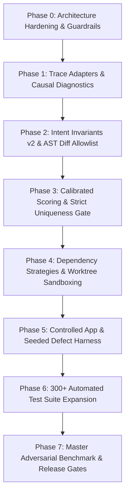

# Master Engineering Implementation Plan

This document details the multi-phase implementation roadmap executed to transform the baseline codebase into the enterprise-grade **Playwright Intelligence Engine (v2.4)**.

---

## 1. Phase Milestones & Execution Flow

---

## 2. Phase-by-Phase Deliverables

### Phase 0: Architecture Hardening & Guardrails
- **Deliverables**:
  - Establish project contracts, TypeScript strict configurations, and typed error taxonomies.
  - Fix Zip-Slip and decompression bomb defenses in `ArchiveReader`.
  - Introduce `DiffAllowlistValidator` to reject collateral AST mutations.

### Phase 1: Trace Adapters & Causal Diagnostics
- **Deliverables**:
  - Implement `TraceAdapterRegistry` supporting schemas v5 through v10.
  - Build `V8TraceAdapter`, `V9TraceAdapter`, `V10TraceAdapter`, and `UnknownTraceAdapter`.
  - Implement `SnapshotResolver` with provenance metadata (`frameId`, `callId`, `phase`) and completeness classification.
  - Implement `EvidenceCorrelator` with Causal Evidence Graph and telemetry filtering (Google Analytics, Sentry, Datadog).

### Phase 2: Intent Invariants v2 & AST Patching
- **Deliverables**:
  - Formalize $V = A \land T \land F \land I \land D \land E$.
  - Build canonical expectation AST hasher (whitespace and formatting insensitive).
  - Implement structural test body statement validator.
  - Support 5 Page Object patterns in `AstPatcher`.
  - Reject dynamic parameterized methods (`userRow(id)`) with `AST_PARAMETERIZED_LOCATOR`.

### Phase 3: Calibrated Scoring & Strict Uniqueness Gate
- **Deliverables**:
  - Implement multi-factor scoring formula $S(L) = 0.40 \cdot S_{role} + 0.25 \cdot S_{attr} + 0.15 \cdot S_{struct} + 0.10 \cdot S_{loc} + 0.10 \cdot S_{vis} - P_{dynamic}$.
  - Implement calibrated logistic sigmoid $P(\text{valid})$.
  - Fix strict element uniqueness boundary bug: enforce hard gate $matchCount === 1$.
  - Implement ambiguity delta gate ($\Delta \ge 0.08$).

### Phase 4: Dependency Strategies & Worktree Sandboxing
- **Deliverables**:
  - Implement `DependencyStrategyResolver` (`NpmStrategy`, `PnpmStrategy`, `YarnPnpStrategy`).
  - Windows NTFS directory junction management with safe pre-unlinking to protect root `node_modules`.
  - Process lifecycle tracking (`isProcessAlive`) and exponential backoff on Windows `EBUSY`/`EPERM` locks.
  - Worktree state tracking in `.pw-intelligence/worktrees/registry.json`.

### Phase 5: Controlled Benchmark Application & Defect Oracle
- **Deliverables**:
  - Implement `ControlledAppServer` (`benchmarks/controlled-app/app-server.ts`) on port 4173 with reproducible DB.
  - Seed 6 distinct business defects (`DEFECT_INVALID_PAYMENT_ACCEPTED`, `DEFECT_WRONG_TOTAL`, `DEFECT_MISSING_VALIDATION`, `DEFECT_WRONG_RECORD_UPDATED`, `DEFECT_UNAUTHORIZED_ACTION`, `DEFECT_INCORRECT_WORKFLOW`).
  - Implement Page Object (`controlled-app.page.ts`) and Spec (`controlled-app.spec.ts`).
  - Build `DefectResistanceHarness` for Experiment C.

### Phase 6: Automated Test Suite Expansion (300+ Tests)
- **Deliverables**:
  - Deliver 18 test suites covering 329 automated test cases.
  - Achieve 100% test pass rate across unit, integration, adversarial, and security suites.
  - Document complete test coverage matrix in `docs/TEST_COVERAGE_MATRIX.md`.

### Phase 7: Master Adversarial Benchmark & Release Gates
- **Deliverables**:
  - Build `MasterBenchmarkRunner` with 104 distinct scenarios across Tier 1 (24 baselines), Tier 2 (50 mutations), and Tier 3 (30 negative controls & business defects).
  - Compute Wilson 95% confidence intervals and P50/P95 latencies.
  - Verify all 7 Release Gates.
  - Produce complete technical documentation suite.

