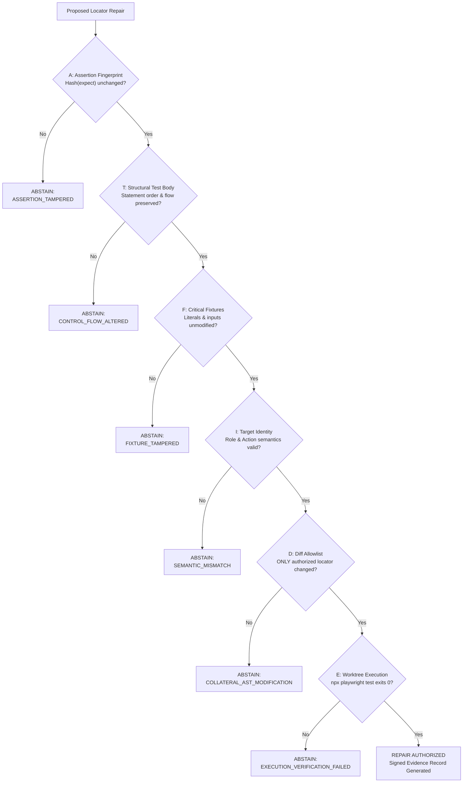

# Intent Invariants Specification (v2.0)

This document provides the formal mathematical and structural specification for **Intent Invariants v2**, the safety engine governing all code modifications in **Playwright Intelligence Engine**.

---

## 1. The Core Problem: Why Assertion Fingerprinting Alone Fails

In v2.3 and common academic auto-healing prototypes, self-healing engines evaluated candidate patches using **Assertion Fingerprinting ($A$)**: hashing the AST nodes of all `expect(...)` statements in the test file before and after patching.

While $A$ prevents an agent from directly modifying `expect(page.getByText('Success')).toBeVisible()`, an autonomous agent or heuristic generator can still defeat the test's intent without modifying any `expect()` statement:

1. **Fixture Mutation Attack**: The agent alters the test data (e.g. changing an invalid credit card string into a valid card, or reducing order items from 5 to 1) so a broken test passes green.
2. **Control Flow Deletion Attack**: The agent deletes preparatory steps (e.g. deleting the step that attempts to click the broken button) or wraps assertions in conditionals that never execute (`if (false) expect(...)`).
3. **Semantic Target Swapping Attack**: The agent repoints a failing locator for a critical action (e.g. `submitButton = page.locator('#submit')`) to an unrelated benign button (e.g. `submitButton = page.locator('#cancel')`). The assertion passes because the cancel dialog closes, but the underlying business feature is completely unexercised!
4. **Collateral AST Injection Attack**: The agent alters TypeScript imports, overrides helper methods, or modifies page class constructors to circumvent application validations.

---

## 2. Formal Formulation: The Six-Dimensional Invariant ($V$)

To establish an uncircumventable safety guarantee, Playwright Intelligence Engine enforces the composite invariant $V$:

$$V = A \land T \land F \land I \land D \land E$$

Where all six predicates must evaluate to `true` for a proposed repair to be authorized:

---

## 3. Mathematical & Algorithmic Specifications

### 3.1. $A$: Assertion Fingerprint Invariant
Computes a SHA-256 hash over all assertion call expressions in the test spec AST.
- **Canonical Normalization**:
  To ensure the invariant is whitespace- and formatting-insensitive, all AST nodes are canonicalized:
  1. Whitespace sequences are collapsed to single spaces: `s/\s+/ /g`.
  2. Spaces surrounding punctuation tokens `([().,{}:])` are removed.
  3. Comments and trailing semicolons are stripped.
- **Formulation**:
  $$H(A) = \text{SHA256}\left(\sum_{i=1}^{n} \text{Normalize}\left(\text{AST}(\text{expect}_i)\right)\right)$$
  $$A = (H(A_{\text{pre}}) == H(A_{\text{post}}))$$

### 3.2. $T$: Structural Test Body Invariant
Validates that the sequence, nesting, and statement kinds of the test body AST have not been altered:
- The count of statements in the test block must be invariant: $N_{\text{pre}} == N_{\text{post}}$.
- Statement kinds (e.g. `ExpressionStatement`, `IfStatement`, `ForStatement`) must match by index.
- No new control flow branches or early returns may be inserted.

### 3.3. $F$: Critical Fixture Invariant
Scans the test AST for literal values (string literals, numeric literals, boolean literals, object literals) passed to page actions or setup fixtures:
- Hashes all argument literals passed to `.fill()`, `.selectOption()`, `.goto()`, and API requests.
- Prohibits mutative alterations of test data payloads.

### 3.4. $I$: Target Identity & Action Semantics Invariant
Verifies that the new locator points to an element whose accessible role, tag, and intent match the failed action:
- **Action Compatibility Matrix**:
  - `click`: Requires tag $\in \{\text{button, a, input[type=submit], input[type=button]}\}$ or ARIA role $\in \{\text{button, link, tab, menuitem, checkbox}\}$.
  - `fill`: Requires tag $\in \{\text{input, textarea, select}\}$ or ARIA role $\in \{\text{textbox, combobox, searchbox}\}$.
- **Token Overlap Rule**:
  Normalized semantic tokens of the candidate (derived from text, accessible name, or test ID) must have a non-empty intersection with the original locator tokens:
  $$\text{Tokens}(L_{\text{candidate}}) \cap \text{Tokens}(L_{\text{original}}) \neq \emptyset$$

### 3.5. $D$: Diff Allowlist AST Invariant (`DiffAllowlistValidator`)
Enforces strict lexical boundaries on source code modifications:
1. **Allowed Mutation**: Exactly ONE class property initializer, getter return statement, constructor property assignment, or locator variable declaration.
2. **Disallowed Mutations**:
   - `ImportDeclaration`: Prohibited. No new packages, modules, or mock libraries may be imported.
   - `MethodDeclaration`: Prohibited. No existing methods may be changed or added.
   - `ConstructorDeclaration`: Prohibited (outside direct locator assignment).
   - Injected statements or decorators: Strictly prohibited.

### 3.6. $E$: Execution Invariant
The proposed repair must execute cleanly in an isolated Git worktree:
- Command: `npx playwright test <specPath> --config=<configPath>`
- Exit Code: `0`
- Zero timeouts, zero strict-mode violations, zero failed assertions.

---

## 4. Empirical Defect Resistance Verification

This six-dimensional invariant was verified against the local controlled application in **Experiment C**:
- **Seeded Business Defects**: 6 distinct defects (invalid payment accepted, wrong order total, missing field validation, wrong record updated, unauthorized admin action, invalid workflow transition).
- **Result**:
  - Seeded defects detected: **6 / 6 (100%)**.
  - Defect masking rate: **0.0%**.
  - False repairs accepted: **0 / 6 (0.0%)**.
  - The engine strictly abstained on every business defect, refusing to weaken assertions or repoint locators to false targets.
