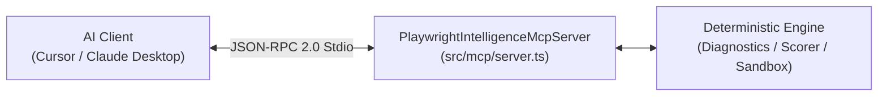

# Model Context Protocol (MCP) Integration Guide

This document describes how to integrate the **Playwright Intelligence Engine** as a native Model Context Protocol (MCP) server for AI developer tools such as **Cursor**, **Claude Desktop**, and other MCP-compliant IDEs.

---

## 1. Overview of MCP Server Architecture

The engine includes a native JSON-RPC 2.0 stdio server implementation conforming to the official Model Context Protocol specification. It allows AI assistants to query Playwright trace diagnostics, score DOM candidates, and request verified repairs directly within the developer's chat or composer interface.



---

## 2. Configuration & Setup

### 2.1. Cursor Configuration
In your project or global Cursor settings (`.cursor/settings.json` or global `settings.json`), add the server definition under `mcpServers`:

```json
{
  "mcpServers": {
    "playwright-intelligence": {
      "command": "node",
      "args": [
        "d:/Work/playwright-intelligence-engine/dist/index.js",
        "mcp"
      ],
      "env": {
        "NODE_ENV": "production"
      }
    }
  }
}
```

### 2.2. Claude Desktop Configuration
In Claude Desktop's configuration file:
- **macOS**: `~/Library/Application Support/Claude/claude_desktop_config.json`
- **Windows**: `%APPDATA%\Claude\claude_desktop_config.json`

```json
{
  "mcpServers": {
    "playwright-intelligence": {
      "command": "node",
      "args": [
        "D:\\Work\\playwright-intelligence-engine\\dist\\index.js",
        "mcp"
      ]
    }
  }
}
```

---

## 3. Supported MCP Tools Reference

The server exposes the following strongly typed tools:

### Tool 1: `diagnose_trace`
Ingests a Playwright trace archive and returns failure classification, causal graph analysis, and diagnostic provenance.
- **Parameters**:
  - `tracePath` (string, required): Workspace-relative or absolute path to `trace.zip`.
- **Output Schema**:
  ```json
  {
    "content": [{ "type": "text", "text": "Diagnostic Report..." }],
    "classification": {
      "category": "LOCATOR_DRIFT",
      "confidence": 0.95,
      "reason": "Locator timed out...",
      "shouldAbstain": false
    },
    "causalGraph": {
      "nodes": [...],
      "edges": [...]
    }
  }
  ```

---

### Tool 2: `repair_page_object`
Safely refactors a Playwright Page Object file using `ts-morph` AST within the authorized workspace, with strict locator grammar and assertion immutability validation ($V = A \land T \land F \land I \land D \land E$).

**Two-Stage Workflow**:
1. **Proposal Mode (without `approvalToken`)**:
   Stages the proposal in `ApprovalService` in-memory. Returns `proposalId`, proposed unified diff, and staging metadata without modifying disk and without leaking auto-usable bearer tokens.
2. **Apply Mode (with `approvalToken`)**:
   Validates the token's cryptographic binding (target path, AST hash, diff hash, TTL) and promotes the patch atomically to the workspace using `WorkspacePromoter` (cooperative file lock, CAS source hash verification, and atomic `fs.renameSync`).

- **Parameters**:
  - `pomPath` (string, required): Path to Page Object file within workspace.
  - `testPath` (string, required): Path to test spec file within workspace.
  - `className` (string, required): Page Object class name.
  - `memberName` (string, required): Target locator member name.
  - `replacementSelector` (string, required): Replacement locator expression.
  - `approvalToken` (string, optional): Cryptographic single-use approval token.
- **Output**: proposal ID and unified diff in proposal mode, or an applied status
  after a valid, verified approval token.

---

### Tool 3: `repair_trace`

Builds the complete trace-to-repair workflow. Deterministic classification and
abstention run first. Proposal mode stages a diff without modifying the active
workspace. With `execute: true`, the proposed patch is tested only in an
isolated worktree; explicit approval is still required before promotion.

- `tracePath` (string, required)
- `errorContextPath` (string, optional)
- `testPath`, `pomPath`, `className`, `memberName` (required to build a proposal)
- `configPath`, `execute`, `worktreeId` (optional)
- Returns `ABSTAINED`, `INPUT_REQUIRED`, `PROPOSAL_READY`,
  `OPERATION_PROPOSAL_ONLY`, `VERIFIED_READY_FOR_APPROVAL`, or `REJECTED`.

### Tool 4: `propose_repair`

Runs one bounded model-proposal step over a redaction-attested diagnostic
bundle. Deterministic classification runs first; environment, application,
assertion, and other hard-abstention failures do not cross the model boundary.
The tool returns a structured proposal or abstention and never edits, executes,
approves, or promotes source.

Configure an OpenAI-compatible provider only when desired:
`PIE_LLM_ENDPOINT`, `PIE_LLM_MODEL`, optional `PIE_LLM_API_KEY`, and optional
`PIE_LLM_TIMEOUT_MS`.

### Tool 5: `analyze_repository_impact`

Discovers direct relative imports and tags from the authorized repository's
Playwright test files, then selects tests affected by the supplied
`changedFiles` array. It reports explicit limitations for aliases and dynamic
runtime dependencies.

### Tool 6: `initialize_project`

Creates or loads `.pie/config.json` in the authorized workspace. This is
idempotent and does not modify application or test source files.

### Tool 7: `profile_repository`

Builds and persists `.pie/repository-profile.json` with repository conventions,
locator usage, fixtures, storage state, API helpers, tags, and evidence sources.

### Tool 8: `cluster_failures`

Accepts normalized failure observations and returns deterministic clusters,
severity, affected repositories, affected tests, and evidence consistency.

### Tool 9: `suite_health`

Accepts run observations and returns pass rates, flaky-test status, duration
percentiles, and failure-cluster history.

### Tool 10: `compile_repair_operation`

Validates an allowlisted operation and returns an immutable proposal. Frame and
open-shadow locator scope can become isolated-verification proposals. Overlay,
prerequisite, select-flow, and wait-flow operations remain proposal-only until
dedicated executors are available.

### Tool 11: `get_product_status`

Returns the current PIE package/milestone identity, fail-closed policy, approval
requirements, and available capability boundaries. This is read-only and is
intended for IDEs and agents that need to discover supported operations before
requesting a repair.

---

### Tool 12: `generate_playwright_test`
Generates enterprise-grade TypeScript Playwright Page Object and spec code with web-first assertions.
- **Parameters**:
  - `featureName` (string, required): Name of the feature or page (e.g. `"UserCheckout"`).
  - `baseUrl` (string, optional): Target application URL.
  - `steps` (array of objects, required): Array of interaction steps (`action`, `name`, `role`, `value`).
- **Output Schema**:
  ```json
  {
    "pageObjectName": "UserCheckoutPage",
    "pageObjectCode": "export class UserCheckoutPage { ... }",
    "specCode": "import { test, expect } from '@playwright/test'; ..."
  }
  ```

---

## 4. Error Handling & Standards Compliance

The server adheres strictly to JSON-RPC 2.0 specifications:
- `Invalid Request` (`-32600`): Returned when incoming payload is not valid JSON-RPC 2.0.
- `Method Not Found` (`-32601`): Returned when unknown RPC methods are invoked.
- `Invalid Params` (`-32602`): Returned when tool arguments fail validation.
- `Internal Error` (`-32603`): Returned on unhandled internal exceptions.
- `Tool Execution Error` (`-32000`): Returned when an engine tool encounters a domain or diagnostic error (e.g. `ZipSlipSecurityError` or `AbstentionError`).

