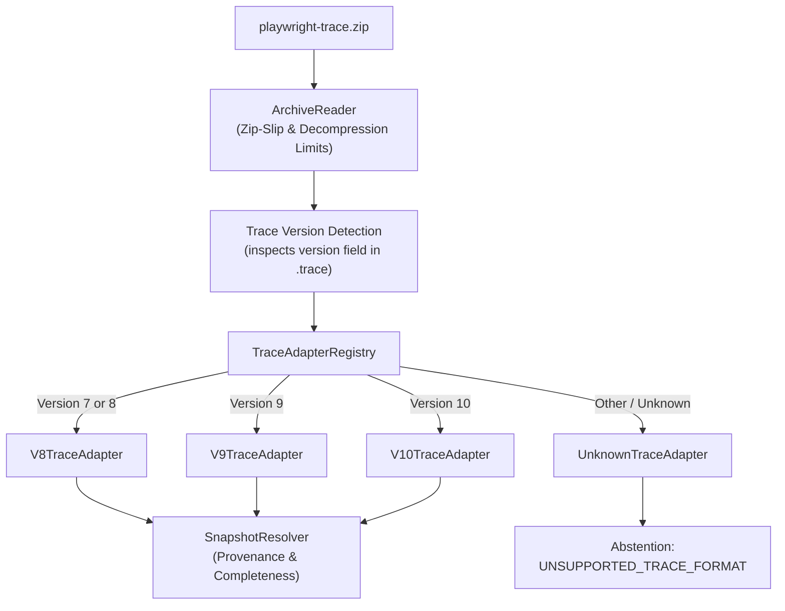

# Trace Compatibility & Adapters (v5–v10)

This document specifies the trace format support, adapter architecture, snapshot resolution pipeline, and error handling mechanisms implemented in **Playwright Intelligence Engine**.

---

## 1. Playwright Trace Format Evolution

Microsoft Playwright traces are ZIP archives containing event logs (`.trace`), network logs (`.network`), and DOM snapshot resources (`.stacks`, `resources/`). The internal event schema has evolved across major Playwright versions:

| Trace Schema | Playwright Version | Key Characteristics | Adapter Implementation |
| :--- | :--- | :--- | :--- |
| **v5 / v6** | Playwright 1.20–1.29 | Legacy flat snapshot arrays, early call metadata | Normalized by `V8TraceAdapter` |
| **v7 / v8** | Playwright 1.30–1.39 | Introduced `beforeSnapshot` / `afterSnapshot` pairs | `V8TraceAdapter` |
| **v9** | Playwright 1.40–1.44 | Structured array-based NodeSnapshot tuples | `V9TraceAdapter` |
| **v10** | Playwright 1.45+ | Enhanced ARIA trees, frame-level provenance | `V10TraceAdapter` |
| **Unknown** | Future / Unreleased | Unrecognized schemas | `UnknownTraceAdapter` (Abstains) |

---

## 2. Adapter Architecture (`src/trace/adapters/`)

The engine employs a modular registry pattern:



### Trace Adapter Interface
```typescript
export interface TraceAdapter {
  readonly supportedVersions: number[];
  canHandle(version: number): boolean;
  parseEvents(traceContent: string): TraceEvent[];
  extractActions(events: TraceEvent[]): ActionEvent[];
  extractSnapshots(events: TraceEvent[]): SnapshotEvent[];
}
```

When an unknown trace schema version is encountered, `UnknownTraceAdapter` deliberately rejects the file:
```typescript
throw new DiagnosticError(
  DiagnosticCategory.UNSUPPORTED_TRACE_FORMAT,
  `Unsupported Playwright trace schema version: ${version}. Supported versions: 5, 6, 7, 8, 9, 10.`
);
```
This prevents corrupted or misaligned repairs from running on unknown data models.

---

## 3. DOM Snapshot Tuples & Resolution

Playwright stores DOM trees as compressed array-based `NodeSnapshot` tuples to minimize file size. A typical element node is serialized as:

```json
[
  "button",
  {
    "id": "submit-btn",
    "class": "btn btn-primary",
    "data-testid": "checkout-submit",
    "aria-label": "Complete Order"
  },
  [ /* children */ ]
]
```

### `SnapshotResolver` Pipeline
The `SnapshotResolver` transforms raw tuples into fully typed `ResolvedElement` objects:
- **Provenance Tracking**: Each resolved element records its origin:
  - `frameId`: Unique ID of the iframe or root document.
  - `callId`: The specific action ID that captured the snapshot.
  - `phase`: `before` (pre-action state) or `after` (post-action state).
- **Completeness Grading**:
  - `COMPLETE`: Full DOM hierarchy with root document, geometry, and attribute maps.
  - `PARTIAL`: Subtree captured, but iframe or detached references were unresolved.
  - `UNAVAILABLE`: Snapshot stream was empty or severed before action completion.
- **Unresolved References**: If snapshot node IDs reference missing parents, an explicit warning flag `unresolvedReferences: true` is populated, notifying the scorer to adjust confidence downward.

---

## 4. Archive Security & Decompression Guards (`ArchiveReader`)

Malicious or malformed ZIP archives represent an attack vector in CI/CD environments. The engine applies four layers of security validation before parsing:

1. **Zip-Slip Traversal Prevention**:
   Every entry path is validated to guarantee it does not escape the target directory:
   ```typescript
   const resolvedPath = path.resolve(destDir, entry.entryName);
   if (!resolvedPath.startsWith(destDir)) {
     throw new ZipSlipSecurityError(`Malicious entry detected: ${entry.entryName}`);
   }
   ```
2. **Decompression Bomb Defense**:
   Limits maximum uncompressed output to **100 MB** total across the archive.
3. **Compression Ratio Defense**:
   Enforces a maximum decompression ratio of **10:1**. Any archive with suspicious ratios (e.g. 1000:1) is aborted.
4. **Archive Entry Cap**:
   Rejects archives containing more than **10,000 individual entries**.
5. **Streaming JSONL Limits**:
   JSONL lines exceeding **16 MB** are rejected to prevent heap exhaustion.

---

## 5. Provenance & Incomplete Evidence Handling

If a trace is truncated (e.g. CI runner was killed during test execution), the engine evaluates completeness:
- If `action` exists but DOM snapshots are missing: Classifies as `INCOMPLETE_EVIDENCE` and abstains.
- If network log is truncated: Causal correlation is restricted to available events and flagged as tentative.
- The engine **never guesses** missing DOM state.
