# PIE v2.6 Comprehensive Remediation Plan & Source-Backed Truth Matrix
## Enterprise Remediation Implementation: Gates A, B, and C

**Document Version:** 2.6.0  
**Baseline Commit:** `894adf1` (Audited Baseline: `3dba885`)  
**Date:** November 2026  
**Auditor Finding Baseline:** AUDIT-01 through AUDIT-16 (Canonically Aligned)  
**Execution Strategy:** Autonomous 4-Milestone Engineering Lifecycle  

---

## 1. Source-Backed Truth Matrix

Before introducing modifications, this matrix establishes the exact active implementation state of claimed features against actual source files, call sites, and test coverage:

| Claimed Capability | Source Implementation | Active Call Sites | Tests | Verified Status |
| :--- | :--- | :--- | :--- | :--- |
| **Central Approval Token** | `src/repair/approval-service.ts` | `src/mcp/server.ts` (lines 312, 372) | `tests/unit/adversarial-safety-remediation.test.ts` (1 test) | **PARTIALLY FIXED**: Token returned in same response as proposal; hashes only replacement string; TOCTOU risk; no worktree pre-run. |
| **Fail-Closed Intent Invariant v2** | `src/repair/intent-validator.ts` | `src/repair/repair-planner.ts:188`, `master-benchmark-runner.ts:353` | `ast-patching-and-invariants.test.ts`, `adversarial-safety-remediation.test.ts` | **PARTIALLY FIXED**: `validateV2` fails closed in default mode, but accepts pre-flight mode; MCP route does not invoke `validateV2`. |
| **Recursive AST Grammar Validation** | `src/repair/diff-allowlist.ts` | `src/repair/intent-validator.ts`, `src/mcp/server.ts` | `ast-patching-and-invariants.test.ts` | **SUBSTANTIALLY IMPROVED**: Blocks `process.env`, calls, arrow functions; accepts string literals bare and diff comparison skips target body. |
| **Canonical Path Containment** | `src/sandbox/worktree-manager.ts`, `src/mcp/server.ts` | `assertPathInWorkspace()` in `server.ts` | `worktree-and-dependency-isolation.test.ts` | **PARTIALLY FIXED**: `worktree-manager.ts` uses lexical `.startsWith()`; `assertPathInWorkspace` falls back to lexical on `realpathSync` failure. |
| **Dependency Strategy Validation** | `src/sandbox/dependency-strategy.ts` | `src/sandbox/worktree-manager.ts:80` | `worktree-and-dependency-isolation.test.ts` | **NOT FIXED**: `strategy.validate(worktreePath)` is invoked, but returned `validation.isValid` boolean is ignored. |
| **ExecutionRunner Hardening** | `src/sandbox/execution-runner.ts` | `DiagnosticRerunner`, `RepairPlanner` | `phase1-diagnostics.test.ts`, unit tests | **PARTIALLY FIXED**: `explicitEnv` overrides bypass whitelist; output bounded by JS string length, not bytes; fixed signal exit code 143. |
| **Multi-Source Evidence Collectors** | `src/collectors/*.ts` (7 collectors) | `DiagnosticRerunner` imports 5 collectors (no live-browser or network) | `multi-source-collectors.test.ts` | **PARTIALLY FIXED**: `LiveBrowserCollector` & `NetworkCollector` have 0 active callers in `src/`. |
| **Live Browser Reproduction** | `src/reproduce/diagnostic-rerunner.ts` | `src/cli/index.ts` (`pw-intel reproduce`) | None end-to-end | **NOT FIXED**: Absolute spec path runs against original workspace; no live collectors attached; no live candidate verification. |
| **Bare Tag Fallback Elimination** | `src/selector/candidate-extractor.ts` | `master-benchmark-runner.ts` | `candidate-extraction-and-scoring.test.ts` | **NOT FIXED**: `candidate-extractor.ts:92` explicitly returns `${pageProperty}.locator('${el.tag}')`. |
| **Page Object Page Property Discovery** | `src/selector/candidate-extractor.ts` | `candidate-extractor.ts:23-30` | `candidate-extraction-and-scoring.test.ts` | **PARTIALLY FIXED**: Substring check (`source.includes('this._page')`), not AST-based class property discovery. |
| **Central Evidence Redaction** | `src/evidence/evidence-redactor.ts` | In individual collectors | `evidence-redactor.test.ts` | **PARTIALLY FIXED**: `redactRecord` has 0 production call sites; live HTML DOM snapshot stored unredacted with `isRedacted: false`. |
| **Action-Anchored Causal Graph** | `src/diagnostics/evidence-correlator.ts` | `failure-classifier.ts` | `failure-classification-and-correlation.test.ts` | **PARTIALLY FIXED**: Correlator sorts suspicious events, but `classify()` runs on unfiltered context; `INITIATED_BY`/`CONTRADICTS` unused. |
| **Stability Ledger** | `src/memory/stability-ledger.ts` | Legacy `benchmark-harness.ts` | `phase3-intelligence.test.ts` | **UNIT ONLY**: Not called in active CLI or repair pipeline; no cross-CI persistence demonstrated. |
| **104-Scenario Empirical Benchmark** | `benchmarks/runner/master-benchmark-runner.ts` | `src/cli/index.ts` (`pw-intel benchmark`) | Benchmarks | **NOT FIXED**: Tier 1 is raw HTTP (no browser); Tier 2 is in-memory synthetic DOM; Tier 3 is unit-style mock contexts; metrics hardcoded. |

---

## 2. Canonical Finding Reconciliation (AUDIT-01 to AUDIT-16)

To eliminate the numbering discrepancies between `docs/IMPLEMENTATION_BASELINE.md` and `docs/FINAL_ENGINEERING_REPORT.md`, the following sequence is authoritative across all codebase documents:

| Canonical ID | Severity | Canonical Title | Primary Source File | Remediation State |
| :--- | :--- | :--- | :--- | :--- |
| **AUDIT-01** | **P0** | Synthetic Benchmark Execution | `benchmarks/runner/master-benchmark-runner.ts` | **NOT FIXED** — Tier 1 is raw HTTP, Tier 2 is in-memory synthetic candidate scoring, Tier 3 is classifier tests; hardcoded metric constants. |
| **AUDIT-02** | **P0** | MCP Direct-Write Bypass & Approval Flaws | `src/mcp/server.ts` | **PARTIAL** — Direct write prevented without token, but token returned in proposal response; writes directly to workspace upon receipt; no worktree pre-run. |
| **AUDIT-03** | **P0** | `RepairPlanner` Direct-Write Bypass | `src/repair/repair-planner.ts` | **FIXED NARROWLY** — Legacy direct write removed; returns proposal only. |
| **AUDIT-04** | **P0** | IntentValidator Fail-Open Defaults | `src/repair/intent-validator.ts` | **PARTIAL** — Default mode is fail-closed ($V = A \land T \land F \land I \land D \land E$), but pre-flight mode can be abused; MCP does not invoke `validateV2`. |
| **AUDIT-05** | **P0** | Symlink / Junction Workspace Escape | `src/mcp/server.ts`, `worktree-manager.ts` | **NOT FULLY FIXED** — Lexical `.startsWith` in `worktree-manager.ts`; fallback to lexical in `server.ts` on `realpathSync` error. |
| **AUDIT-06** | **P0** | Worktree ID Path Traversal | `src/sandbox/worktree-manager.ts` | **REGEX FIXED** — Regex `/^[a-zA-Z0-9_-]{1,64}$/` implemented, but lexical path checks remain. |
| **AUDIT-07** | **P0** | Nested Locator Argument Injection | `src/repair/diff-allowlist.ts` | **SUBSTANTIALLY IMPROVED** — Recursive argument AST validation active; bare string literal permitted. |
| **AUDIT-08** | **P0** | ExecutionRunner Signal Exit Code Masking | `src/sandbox/execution-runner.ts` | **PARTIAL** — Non-zero exit code enforced on signal, but fixed at `128 + 15` rather than actual signal. |
| **AUDIT-09** | **P0** | TraceParser False DOM Completeness | `src/trace/trace-parser.ts` | **FIXED NARROWLY** — `domAvailable` correctly reflects `snapshots.length > 0`, but trace parser does not load DOM snapshots. |
| **AUDIT-10** | **P0** | ArchiveReader Size, Ratio, and Pairing Gaps | `src/trace/archive-reader.ts` | **PARTIAL** — 100MB aggregate limit and 10:1 ratio check implemented, but ratio check bypassed for entries $\le 512$ KB. |
| **AUDIT-11** | **P1** | Trace Monoculture & Unattached Collectors | `src/reproduce/diagnostic-rerunner.ts` | **PARTIAL** — Collector classes exist, but `LiveBrowserCollector` and `NetworkCollector` are not attached; absolute spec path bug. |
| **AUDIT-12** | **P1** | Non-Causal Network Classification | `src/diagnostics/evidence-correlator.ts` | **PARTIAL** — Action timestamp anchored, but classifier inspects raw unfiltered events before correlator filtering; missing edge types. |
| **AUDIT-13** | **P1** | Unverified Uniqueness & Bare Tag Fallback | `src/selector/candidate-extractor.ts` | **NOT FIXED** — Line 92 returns bare `locator(tag)`; substring search for page property; uniqueness not verified live in browser. |
| **AUDIT-14** | **P1** | Non-Atomic Patch Application & TOCTOU | `src/repair/ast-patcher.ts`, `src/mcp/server.ts` | **PARTIAL** — Atomic temp-file write exists in `ast-patcher.ts`, but MCP has TOCTOU between token consumption and patch. |
| **AUDIT-15** | **P1** | Subprocess Environment Leakage & Output Limit | `src/sandbox/execution-runner.ts` | **PARTIAL** — `SAFE_ENV_KEYS` whitelist exists, but `explicitEnv` overrides bypass it; string length vs byte limit. |
| **AUDIT-16** | **P1** | Dependency Validation Bypassed | `src/sandbox/worktree-manager.ts` | **NOT FIXED** — `strategy.validate(worktreePath)` called, but `validation.isValid` boolean is ignored. |

---

## 3. Four-Milestone Implementation Architecture

```mermaid
flowchart TD
    subgraph M1["Milestone 1: Gate A — Security & Mutation Integrity"]
        M1_1["Unified Mutation Orchestrator (Worktree-first)\nZero unverified workspace writes"]
        M1_2["ApprovalService: Cryptographic Diff Binding\n(Hash canonical path + class + member + diff + test)"]
        M1_3["Compare-before-write Atomic Promotion with Locks"]
        M1_4["Canonical realpathSync Containment across WorktreeManager"]
        M1_5["Dependency Validation: Fail-closed on isValid === false"]
        M1_6["ExecutionRunner: Strict explicit env whitelist, byte limits, signal tracking"]
        M1_7["CandidateExtractor: Strict elimination of bare tag fallbacks"]
    end

    subgraph M2["Milestone 2: Gate B — True Live Browser Reproduction"]
        M2_1["Fix Absolute Spec Path: Worktree-relative execution"]
        M2_2["Instrumentation Spike & Custom Diagnostic Runner\n(Hook Page console, pageerror, requestfailed, response)"]
        M2_3["Failure-Point Capture (DOM, ariaSnapshot / a11y tree)"]
        M2_4["Typed LocatorPlan & Live page.locator() verification\n(count === 1, isVisible, isEnabled)"]
        M2_5["Central Ingestion Redaction Gateway\n(Every record scrubbed before persistence)"]
        M2_6["Action-Anchored Causal Window piped to Classifier"]
    end

    subgraph M3["Milestone 3: Gate C — Focused Empirical Browser Benchmark"]
        M3_1["Tier 1: 2 Real Playwright Baselines in Headless Chromium"]
        M3_2["Tier 2: 4 Real DOM Drift & Repair Scenarios\n(Fail -> Diagnose live -> Worktree Repair -> Re-run -> Pass)"]
        M3_3["Tier 3: 3 Real Negative Controls\n(Real HTTP 500, Real Business Defect, Duplicate Ambiguity)"]
        M3_4["Empirical Metrics: Pure execution computation\n(No hardcoded rates, isolated Wilson CI)"]
        M3_5["CLI Benchmark Filtering (--family, --scenario, --browser)"]
    end

    subgraph M4["Milestone 4: Verification & Documentation"]
        M4_1["Full Regression Test Battery (Typecheck, Build, Vitest)"]
        M4_2["Synchronize all documentation (README, ARCHITECTURE, etc.)"]
        M4_3["Final Engineering Report v2.6 with Truthful Certification"]
    end

    M1 --> M2 --> M3 --> M4
```

---

## 4. Workstream Deep Dive

### Milestone 1: Gate A — Security & Mutation Integrity
1. **Centralize Mutation Pipeline:**
   - Create a unified `RepairOrchestrator` (or consolidate in `RepairPlanner`).
   - Every mutation must follow: Proposal $\to$ Worktree Mutation $\to$ Test Execution $\to$ Regression Execution $\to$ Intent Invariant v2 Verification $\to$ Verified Proposal $\to$ Explicit Approval $\to$ Guarded Workspace Promotion.
   - MCP `repair_page_object` and CLI `pw-intel repair` invoke this identical pipeline.
2. **ApprovalService Token Hardening:**
   - Bind token to: `proposalId + canonicalPath + originalSourceSha256 + className + memberName + replacementAstHash + fullDiffSha256 + testFileSha256`.
   - Never return an approval token in the proposal response. Proposals output `proposalId` and diff.
   - Approvals require explicit CLI command `pw-intel approve <proposalId>` or local confirmation hook.
3. **Guarded Atomic Workspace Promotion:**
   - Check source hash against original approved hash immediately before write (CAS-style).
   - Write to temporary file `.tmp.<pid>.<uuid>` in the same directory, flush, and atomically replace (`fs.renameSync`).
4. **Canonical Path Containment:**
   - Replace lexical `.startsWith()` in `WorktreeManager` with canonical `path.relative(canonicalBase, canonicalTarget)`. Reject on realpath failure (fail-closed).
5. **Dependency Validation Fail-Closed:**
   - In `WorktreeManager.createWorktree`, throw `SandboxError` if `!validation.isValid`.
6. **ExecutionRunner Hardening:**
   - Filter `explicitEnv` through `SAFE_ENV_KEYS`.
   - Bound buffers strictly by bytes with `truncated: boolean` metadata.
   - Record exact signal (`128 + signalNumber`). Await `taskkill` on Windows.
7. **Eliminate Bare Tag Fallbacks:**
   - Replace line 92 in `candidate-extractor.ts` with typed error `INSUFFICIENT_IDENTIFIERS`.
   - Implement AST-based class property discovery for Page Object Page properties.

### Milestone 2: Gate B — True Live Browser Reproduction
1. **Fix Absolute Spec Path Worktree Containment:**
   - `diagnostic-rerunner.ts`: Resolve `path.relative(repoRoot, specPath)` and execute against `path.join(worktreePath, relativeSpec)`.
2. **Wire Up Real Live Browser Instrumentation:**
   - Implement direct Playwright runner and diagnostic fixture for reproduction.
   - Attach `LiveBrowserCollector` and `NetworkCollector` to the active `Page` and `BrowserContext`.
   - Capture failure-point DOM (`page.content()`) and accessibility snapshot (`page.ariaSnapshot()` or fallback).
3. **Safe Typed LocatorPlan & Live Verification:**
   - Create `LocatorPlan` algebraic data type (`getByRole`, `getByText`, `getByLabel`, `getByTestId`, `locator`).
   - Implement safe dispatcher executing live `count()`, `isVisible()`, `isEnabled()`.
   - Enforce `count() === 1` strictly.
4. **Central Ingestion Redaction Gateway:**
   - Enforce `EvidenceRedactor.redactRecord()` on every record before appending to `UnifiedEvidenceRecord` or `DiagnosticContext`.
5. **Action-Anchored Causal Pipeline:**
   - Pass filtered, frame-matched events directly into `FailureClassifier.classify()`.
   - Emit `INITIATED_BY` and `CONTRADICTS` directed edges in Causal Evidence Graph.

### Milestone 3: Gate C — Focused Empirical Browser Benchmark
1. **Implement Nine Real End-to-End Scenarios:**
   - **Tier 1 (Baselines - 2 scenarios):** Real Chromium launches, runs Login spec and Cart/Checkout spec against `ControlledAppServer`.
   - **Tier 2 (Mutations - 4 scenarios):** Real DOM mutations (Button ID change, CSS class change, accessible name change, container restructuring). Test fails in browser $\to$ PIE diagnoses $\to$ patches in worktree $\to$ re-runs in browser $\to$ turns green.
   - **Tier 3 (Negative Controls - 3 scenarios):** Real HTTP 500 (`/api/defects`), real business defect (wrong total calculated), duplicate ambiguous elements. Test fails $\to$ PIE diagnoses $\to$ strictly abstains with 0 repairs.
2. **Empirical Metrics Engine:**
   - Remove hardcoded constants (`regressionRate = 0.0`, `defectMaskingRate = 0.0`).
   - Compute metrics directly from executed scenario results and independent ground truth.
   - Isolate Classifier Unit Scenarios into a separate suite.
3. **CLI Filtering:**
   - Verify `--family`, `--scenario`, `--browser` actually filter executed browser scenarios.

### Milestone 4: Verification, Hardening & Documentation
1. Run `npm run typecheck`, `npm run build`, `npm test`, and focused empirical benchmark.
2. Update all documentation with truthful claims and synchronized AUDIT IDs.
3. Generate comprehensive certification report.

