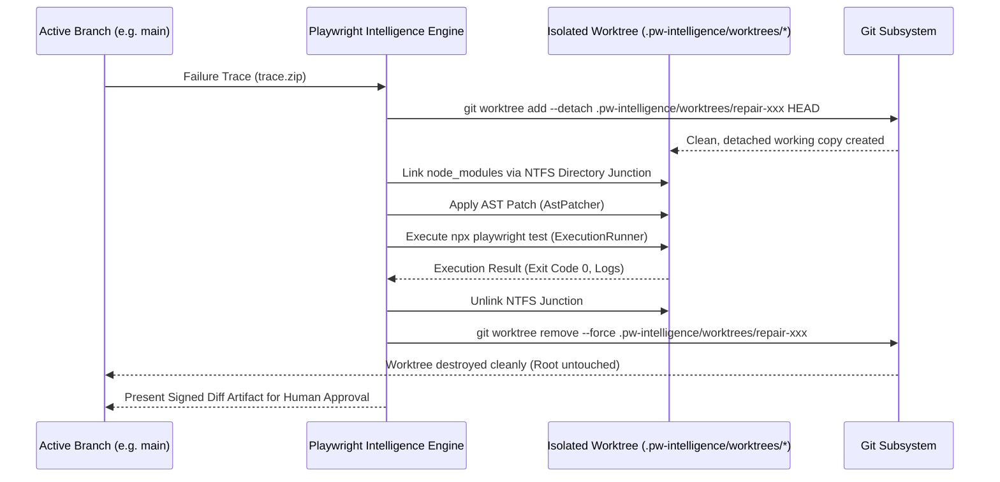

# Git Worktree & Dependency Isolation Specification

This document details the sandboxing architecture, Git worktree lifecycle, dependency sharing strategies, and Windows NTFS safety mechanisms implemented in `src/sandbox/worktree-manager.ts` and `src/sandbox/dependency-strategy.ts`.

---

## 1. Sandboxing Principles & Security Rationale

Modifying source files on the developer's active branch or in shared CI environments introduces catastrophic risks:
- Broken test runs leaving uncommitted dirty diffs in the repository.
- Agent crashes leaving corrupted AST files.
- Simultaneous concurrent test runs colliding on modified files.
- Unauthorized git commits or pushed branches.

**The Worktree Guarantee**:  
Playwright Intelligence Engine **never** touches or alters the active working branch. All repair planning, AST patching, and execution verification occur inside dedicated, isolated Git worktrees located under `.pw-intelligence/worktrees/repair-<id>`.



---

## 2. Dependency Isolation Strategies (`DependencyStrategyResolver`)

Running a full package installation (`npm install`, `pnpm install`, `yarn install`) inside each temporary worktree takes 30–90 seconds, introducing unacceptable diagnostic latency. To achieve sub-second worktree readiness, the engine implements package-manager-specific sharing strategies:

| Strategy | Package Manager | Isolation Mode | Sharing Mechanism | Safety Precautions |
| :--- | :--- | :--- | :--- | :--- |
| **`NpmStrategy`** | `npm` | `IMMUTABLE_SHARED` | Windows NTFS Directory Junction (`symlink(..., 'junction')`) / POSIX Symlink | Read-only usage. Node processes monitored before unlinking. |
| **`PnpmStrategy`** | `pnpm` | `SHARED_MUTABLE` | Directory Junction to `.pnpm` virtual store | Emits warning on shared virtual store mutation risks. |
| **`YarnPnpStrategy`** | `yarn` (PnP) | `UNSUPPORTED` | Virtual filesystem (`.pnp.cjs`) | Rejects worktree creation; PnP symlink incompatibilities flagged. |

---

## 3. Windows NTFS Safety & Collision Prevention

Executing Git worktrees and filesystem symlinks on Windows environments requires specialized OS-level safeguards:

### 3.1. Pre-Unlink Junction Protection (Zero Root Wiping)
On Windows, executing `git worktree remove --force` or recursive directory deletion (`rmdir /s /q` or `fs.rm(..., { recursive: true })`) on a folder containing a directory junction can traverse into the target directory and **wipe the host root `node_modules`**!
- **Solution**: The engine strictly scans and unlinks the NTFS junction *before* invoking `git worktree remove`:
  ```typescript
  const junctionPath = path.join(worktreePath, 'node_modules');
  if (fs.existsSync(junctionPath)) {
    await fs.promises.unlink(junctionPath); // Removes junction pointer only; leaves target intact
  }
  await execFileAsync('git', ['worktree', 'remove', '--force', worktreePath]);
  ```

### 3.2. Windows File Lock & Exponential Backoff (`EBUSY` / `EPERM`)
Windows locks open files (such as DLLs, SQLite DBs, or child process handles) even after process exit, causing `EBUSY` or `EPERM` errors on immediate cleanup.
- **Solution**: The engine implements an exponential retry backoff loop (up to 5 retries with jitter) to allow the OS kernel to release file handles before final deletion.

### 3.3. Process Lifecycle & PID Tracking
Before tearing down a worktree, the engine queries the OS process table (`isProcessAlive(pid)`) to verify that any child test runners, Node processes, or Playwright browser instances spawned inside that worktree have terminated cleanly. Orphaned processes are gracefully signaled (`SIGTERM`) and forcefully killed (`SIGKILL`) if unresponsive.

---

## 4. Worktree Registry & Recovery (`registry.json`)

All active worktrees are recorded in `.pw-intelligence/worktrees/registry.json`:

```json
{
  "worktrees": [
    {
      "id": "repair-1730761200000",
      "path": "d:\\Work\\playwright-intelligence-engine\\.pw-intelligence\\worktrees\\repair-1730761200000",
      "branch": "pw-repair-temp-1730761200000",
      "createdAt": 1730761200000,
      "dependencyStrategy": "IMMUTABLE_SHARED",
      "status": "ACTIVE"
    }
  ]
}
```

Upon engine startup or CLI invocation (`pw-intel audit`), any stale worktrees left behind by abnormal system restarts or crashes are detected and safely purged.
