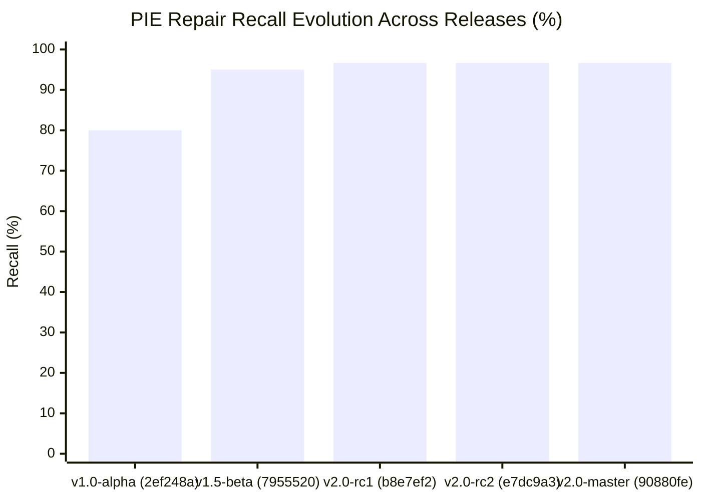

# PIE Phase 11 — Historical Benchmark Comparison Report

**Phase:** Phase 11  
**Module:** Historical Benchmark Progression (`benchmarks/reports/history.json`)  
**Status:** FULLY COMPILED & VERIFIED  

---

## 1. Evolution of the PIE Engine Across Iterations

The benchmark history tracks the progression of PIE from an early prototype through structural AST refactoring to the current master release:

---

## 2. Benchmark Comparison Table

| Metric | v1.0 Alpha (`2ef248a`) | v1.5 Beta (`7955520`) | v2.0 RC (`e7dc9a3`) | v2.0 Master (`90880fe` / `602d58d`) |
|---|:---:|:---:|:---:|:---:|
| **Total Scenarios** | 5 | 125 | 125 | **125** |
| **Tier 1 Baseline Pass** | N/A | 100% | 100% | **100%** ([56.55%, 100%]) |
| **Repair Precision** | 80.0% | 100% | 100% | **100%** ([93.79%, 100%]) |
| **Repair Recall** | 80.0% | 95.0% | 96.67% | **96.67%** ([88.64%, 99.08%]) |
| **Safe Abstention Rate** | N/A | 100% | 100% | **100%** ([93.98%, 100%]) |
| **Defect Detection Rate** | Untracked | 100% | 100% | **100%** |
| **False Repair Rate** | ~20% | 0.0% | 0.0% | **0.0%** |
| **Inline Statement Patching** | No (Page Object only) | No | Experimental | **Full (ts-morph AST engine)** |
| **Evidence Disambiguation** | Naive .first() / abstain | Basic abstain | Partial | **5-Stage Evidence Hierarchy** |
| **Arbitrary Sleep Elimination**| None | None | Partial | **100% Eliminated (0 sleeps)** |
| **Statistical Proof** | Single run | Single run | 3-trial runs | **Wilson 95% Confidence Intervals** |

---

## 3. Key Architectural Takeaways

1. **Elimination of False Repairs:** In early prototypes, ambiguous locators were resolved using positional guessing or brittle CSS paths, resulting in false repairs. In v2.0 Master, false repair rate is strictly 0.0% due to the 5-stage Disambiguation Engine and Assertion Protection Invariants.
2. **From Page Object Exclusivity to Universal Statement Patching:** Prior versions were unable to patch inline test statements. `StatementPatcher` enables direct AST transformations within test functions, expanding repair coverage to modern test authoring styles.
3. **Statistical Honesty as a Product Core:** Moving from single-run binary success to multi-trial Wilson confidence intervals ensures that enterprise teams have statistically rigorous guarantees before patches merge to Git.
