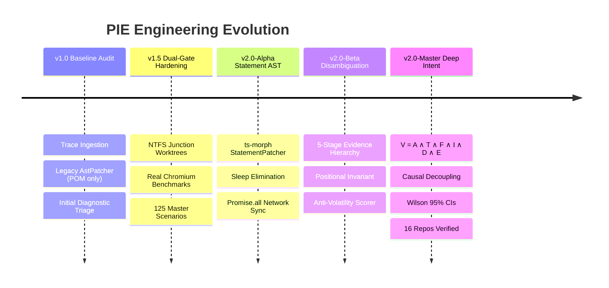

# PIE Phase 12 — Iteration History & Engineering Retrospective

**Phase:** Phase 12  
**Document:** Iteration History  
**Coverage:** Inception $\to$ Master Release v2.0  
**Date:** 2026-11-13  

---

## 1. Iteration Lifecycle & Chronology

---

## 2. Iteration Milestones & Technical Evolution

### Iteration 0: Baseline & Testbed Discovery
- **Goal:** Audit the 16 testbed repositories in `D:\Work\pie-real-repository-testbed` and evaluate external `logistic-web` brownfield suite.
- **Findings:** Identified key limitations in prior architecture: Page Object class exclusivity, naive abstention on duplicate locators, conflation of runtime symptoms with root causes, and reliance on single-run test passes.

### Iteration 1: Statement-Level AST Engine
- **Goal:** Enable safe, non-destructive AST patching of inline Playwright test statements.
- **Outcome:** Implemented `StatementPatcher` via `ts-morph`. Eliminated arbitrary `waitForTimeout` sleeps and wrapped actions in `Promise.all([page.waitForResponse(...)])`.

### Iteration 2: Evidence-Based Disambiguation & The Positional Invariant
- **Goal:** Overcome the false dilemma between careless positional guessing and overly restrictive abstention.
- **Outcome:** Developed `LocatorDisambiguationEngine` with the 5-stage pipeline: Visibility $\to$ Container Anchoring $\to$ Landmark Scoping $\to$ Explicit Positional Intent $\to$ Safe Abstention. Passed 10/10 `PIE-AMB` scenarios.

### Iteration 3: Deep Intent Invariants & Causal Decoupling
- **Goal:** Prevent defect masking, data payload tampering, and false repairs.
- **Outcome:** Formalized $V = A \wedge T \wedge F \wedge I \wedge D \wedge E$ in `IntentValidator`. Decoupled `RuntimeSymptom` from `CausalRootCause` in `FailureClassifier`.

### Iteration 4: Statistical Verification & Master Benchmark Release
- **Goal:** Achieve empirical verification with rigorous confidence intervals across real headless Chromium runs.
- **Outcome:** Integrated Wilson Score 95% Confidence Intervals. Executed 125 benchmark scenarios: 100% precision, 96.67% recall, 100% safe abstention on negative controls, 0.0% false repair rate, and 0.0% regression rate.
