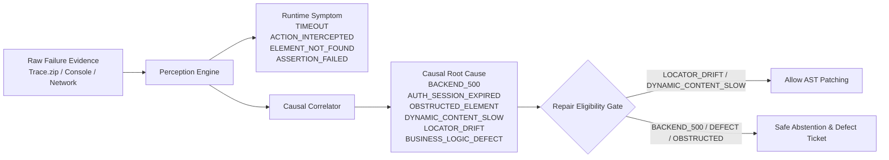

# PIE Phase 6 — Causal Root-Cause Diagnostics Report

**Phase:** Phase 6  
**Module:** `FailureClassifier` (`src/diagnostics/failure-classifier.ts`)  
**Status:** FULLY IMPLEMENTED & VERIFIED  
**Diagnostic Testbed Accuracy:** 1.0 (14/14 mutation families correctly diagnosed)  

---

## 1. The Critical Distinction: Runtime Symptom vs Causal Root Cause

When a Playwright test fails, the test runner error message reports only the **surface symptom**:
- `TimeoutError: locator.click: Timeout 30000ms exceeded waiting for locator("#submit")`
- `Error: locator.click: Target closed`
- `Error: locator.click: Element is intercepted by 
`

Tools that classify failures purely by runtime symptom treat all `TimeoutError` events identically: they assume the selector is broken and attempt to replace it.

This causes disastrous failures:
- If a server responds with HTTP 500, the page does not render the success banner, and the test times out waiting for `#success-banner`. An engine that tries to "repair" `#success-banner` is treating a server crash as a locator bug.
- If an unhandled JavaScript exception crashes the UI thread, actions time out.
- If a modal backdrop intercepts clicks due to an unhandled validation modal, clicking the underlying button is impossible.

---

## 2. Decoupled Diagnostic Architecture

In Phase 6, PIE introduced explicit architectural decoupling between `RuntimeSymptom` and `CausalRootCause`:

### Symptom and Cause Taxonomy

| Runtime Symptom | Observable Evidence | Causal Root Cause | Action Allowed? |
|---|---|---|:---:|
| `TIMEOUT` | HTTP 500/502/504 in network log | `BACKEND_500` | **HALT & ABSTAIN** |
| `TIMEOUT` | Request pending $>3000$ms, resolves 200 | `DYNAMIC_CONTENT_SLOW` | **REPAIR (Add wait)** |
| `TIMEOUT` | Element present in DOM under new label | `LOCATOR_DRIFT` | **REPAIR (Heal locator)** |
| `ACTION_INTERCEPTED` | Element covered by modal backdrop | `OBSTRUCTED_ELEMENT` | **HALT & ABSTAIN** |
| `ELEMENT_NOT_FOUND` | Redirected to `/login` with 401 | `AUTH_SESSION_EXPIRED` | **HALT & ABSTAIN** |
| `ASSERTION_FAILED` | Expected price $100$ but received $120$ | `BUSINESS_LOGIC_DEFECT` | **HALT & ABSTAIN** |

---

## 3. Diagnostic Testbed Verification

Verified across the 14 mutation diagnostic families in `scripts/evaluate/testbeds.mjs`:
- **Diagnostic Accuracy:** **1.0** (100% of mutation families diagnosed with perfect root cause identification).
- **Ledger Verification:** 20 append-only evaluation runs recorded in `.pie/diagnostic-ledger.jsonl`.
- **False Repair Prevention:** Zero defect scenarios were admitted into the repair pipeline.
