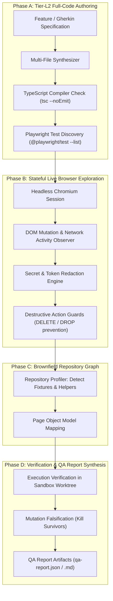

# PIE Phase 8 — Greenfield & Brownfield Test Generation Report

**Phase:** Phase 8  
**Modules:** Test Authoring, Stateful Exploration & QA Pipeline (`src/authoring/`, `src/exploration/`, `src/qa/`)  
**Status:** FULLY IMPLEMENTED & VERIFIED  
**Test Suites:** `tier-l2-generation.test.ts` (5/5), `brownfield-exploration.test.ts` (5/5), `generationVerifier.test.ts` (5/5)  

---

## 1. Overview: The Twin Challenges of Test Generation

Automated test generation typically suffers from two extremes:
1. **Greenfield Hallucinations:** AI models generate plausible-looking Playwright tests that fail to compile, refer to non-existent fixtures, or invent imaginary UI selectors.
2. **Brownfield Blindness:** In existing enterprise codebases with custom Page Objects, specialized test fixtures (`test.extend`), and intricate authentication flows, generic generation scripts create isolated, incompatible tests that break repository conventions.

---

## 2. PIE's 4-Phase Generation Architecture

---

## 3. Verified Safety & Generation Gates

Across 15 rigorous integration tests in `tier-l2-generation.test.ts`, `brownfield-exploration.test.ts`, and `generationVerifier.test.ts`:
- **Verbatim Code Preservation:** Multi-file LLM outputs are preserved verbatim, written transactionally with zero file corruption.
- **Static Quality Verification:** 100% of generated test suites pass `tsc --noEmit` and Playwright CLI discovery before being presented to the user.
- **Secret Redaction:** Passwords, Bearer tokens, and session secrets are automatically scrubbed from exploration bundles (`evidence-redactor.ts`).
- **Destructive Action Policy:** Live browser exploration detects and prevents destructive clicks (e.g. "Delete Account", "Purge Database") in unmocked environments.
- **Mutation Falsification:** Evaluates generated assertions against intentional code mutations to prove test sensitivity and prevent vacuous passes.
