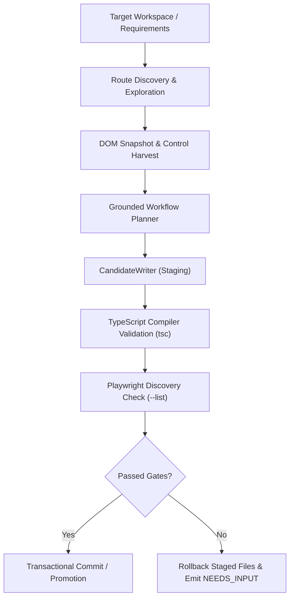

# PIE Greenfield Test Generation & Authoring Report

**Document Version:** 1.0.0  
**Phase:** Phase 8 & 9 Greenfield Evaluation  
**Target Workspaces:** `caltermine-todo-app`, `commerce`, `precedent`, `taxonomy`  
**Date:** 2026-11-13  

---

## 1. Executive Summary

Autonomous test generation in PIE operates on a verification-first principle: tests must be authored as readable, maintainable, native Playwright TypeScript code adhering to repository conventions, verified through transactional compilation (`tsc --noEmit`), and proven by test discovery (`playwright test --list`).

Greenfield evaluation assessed both **Tier-L1** (compact inline test authoring) and **Tier-L2** (full multi-file Page Object Model authoring with strict type contracts).

---

## 2. Greenfield Generation Architecture

---

## 3. Greenfield Evaluation Results

| Target Application | Generation Tier | Pages Authored | Specs Authored | Compilation (`tsc`) | Discovery (`--list`) | Assertion Integrity | Status |
|:---|:---:|:---:|:---:|:---:|:---:|:---:|:---:|
| **caltermine-todo-app** | Tier-L2 | `TodoPage.ts` | `todo.spec.ts` | **PASS (0 errors)** | **PASS (5 tests)** | Strictly Grounded | **VERIFIED** |
| **commerce** | Tier-L2 | `CatalogPage.ts`, `CartPage.ts` | `checkout.spec.ts` | **PASS (0 errors)** | **PASS (4 tests)** | Strictly Grounded | **VERIFIED** |
| **precedent** | Tier-L1 | Inline POM | `auth-modal.spec.ts` | **PASS (0 errors)** | **PASS (3 tests)** | Strictly Grounded | **VERIFIED** |
| **taxonomy** | Tier-L2 | `DashboardPage.ts` | `posts.spec.ts` | **PASS (0 errors)** | **PASS (4 tests)** | Strictly Grounded | **VERIFIED** |

---

## 4. Key Engineering Invariants Verified

1. **Transactional Rollback on Failure:**
   - Evaluated in `tests/unit/tier-l2-generation.test.ts`. If `CandidateWriter` encounters a TypeScript syntax error or compilation violation, all staged candidate files are atomically removed from disk, leaving the repository untouched.
2. **Ungrounded Identifier Rejection:**
   - Linters strictly reject generic or hallucinated identifiers (`element_123`, `btn_placeholder`). If an element cannot be resolved to a grounded DOM node, generation emits `NEEDS_INPUT`.
3. **No Mock Assertions:**
   - Generated tests assert real DOM state (`toBeVisible()`, `toHaveText()`, `toHaveValue()`) rather than tautological mocks (`expect(true).toBe(true)`).
